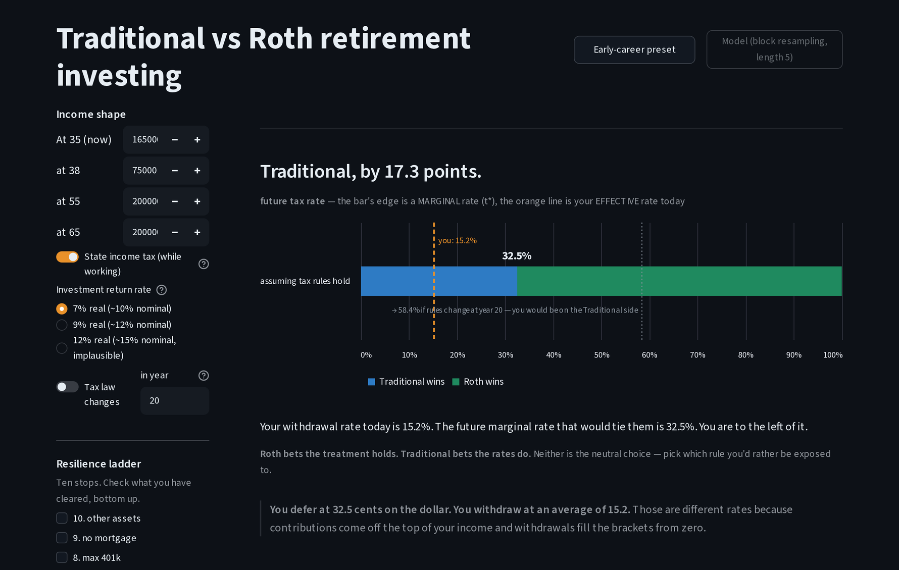

# Traditional or Roth? A threshold spike with a block-bootstrap engine and a fragility ladder

I built this to model a decision whose deciding input nobody knows: your tax rate decades from now.
The app reports the future tax rate at which Traditional and Roth tie, and you locate yourself against it.

**[Live demo](https://roth-vs-traditional-production.up.railway.app/)** · [Findings](docs/FINDINGS.md) · [Essay: *A plan for all seasons*](docs/ESSAY.md)


*Break-even future tax rate (horizontal axis) after zero to three life events (rows), for savers with no buffer, some buffer and a deep buffer. Each dot is one definition of "optimal." The vertical line is your own break-even under today's rules.*

## What I found

1. **The textbook answer is right.**
   The market return cancels out of the comparison.
   Two tax rates decide it: the rate you defer at now and the rate you withdraw at later.
   For the reference saver, the rate now is 32.5% (24% federal plus 8.5% state).
2. **That answer is settled only for savers with a buffer.**
   The app places each saver on a ten-stop ladder (emergency cash, high-interest debt, the employer match and so on), grouped into three rungs: no buffer, some buffer, deep buffer.
   With a buffer, a life event never forces a sale, so the break-even stays at 32.5% however many events arrive.
   With no buffer, each event forces a sale, and three events drag the 10th-percentile break-even down to 24.4%.
   The four definitions of "optimal" (mean, median, 10th percentile, and the chance of not running out) also drift apart there, by up to 1.5 points.
   The textbook answer assumes you never have to sell early, which assumes you have slack.
3. **I published the design claims that failed.**
   I expected one rung of buffer to be worth about four times the account choice in dollars.
   That comparison depends on how far off your guess about your future tax rate turns out to be.
   I fixed that miss at 10 points before running the sweep, and at 10 points the account choice wins.
   [RESULTS](docs/RESULTS.md) records the inversion and where it flips.

## What this is

- A research spike. I spent a week in August 2026 modeling one decision.
- Not a retirement planner, and not advice. The output is a tax rate and a comparison.
- The risk panels are precomputed at one reference profile, and the app says so.
- I settled my own choice long ago. I built this to show how I model a decision like this one, and what a model is for.

## Try it



A 90-second path through the [live app](https://roth-vs-traditional-production.up.railway.app/):

| Do this | Watch for |
|---|---|
| Open the page | *Traditional, by 17.3 points.* You defer at 32.5% and withdraw at an average of 15.2% |
| Switch the return from 7% to 12% | The balances leap, and the 32.5% break-even does not move |
| Press **Early-career preset** | *Roth, by 3.9 points* |
| Turn on **Tax law changes** | Traditional again: the rule change costs the low-bracket saver Roth was supposed to help |
| Untick the first stop on the ladder, $400 of emergency cash | You drop to the no-buffer rung: the verdict gives way to a note about the missing stop, and the dots spread apart |

## Why a threshold, not a verdict

Hadamard called a problem well-posed when it has a solution, only one, and the solution holds still when the inputs move.
This problem fails twice.
Its deciding input is unknowable, so there is no single answer.
Near the break-even, a small change in that input flips the verdict.
So I solve for that input instead: the future tax rate at which the two accounts tie.
You bring the judgment the model cannot make, which is where you expect to land.

Any long-lived choice that rides on a rule someone else controls has this problem.
Rooftop solar is one:

| | Retirement | Rooftop solar |
|---|---|---|
| The unknowable input | Your marginal tax rate in 30 years | The utility's rate escalator over 25 years |
| What to report instead | The break-even tax rate | The break-even escalator |
| The bet you are making | Roth bets the tax treatment holds | Net metering bets the credit rule holds |

## What a model is for

For savers with a buffer, the pencil answer is exact: the break-even equals today's rate at every shock count.
The model derives that before it runs, because a buffer means no forced sale.
For savers without one, a shock forces a sale, and shocks tend to arrive in down markets.
The sale costs the two accounts differently, because Traditional pays tax and a penalty while Roth contributions come out free.
A fixed return gives one path, so it can show what a forced sale costs but not how the outcomes spread.
I stepped the return model from a fixed rate through Monte Carlo to a block bootstrap, which replays real five-year stretches of market history.

Nobody knows which regime a future year will put them in, because a layoff or a medical bill can wipe out a buffer.
A model can still count outcomes: how many paths end in ruin, how many end fine, and for whom.
Someone who has never studied statistics can read a count and see which group they are likely to land in.

My PhD taught me the same lesson.
I modeled radiation damage in the oxide layers of transistors, where two chemical mechanisms compete and each dominates in its own hydrogen regime.
A model that looks wrong in one regime is right in the other.
Knowing the regime tells you which cheap model to trust.
Some effects never separate cleanly, and those need the full model.
Here the buffer is the regime variable.
[FINDINGS](docs/FINDINGS.md) sets the three problems side by side.

## How it's built

The app computes one number and reads all the others.

| Layer | File | What it does |
|---|---|---|
| Constants | `tax.py`, `return_series.py` | 2026 federal brackets from IRS sources, one state rate, and 98 years of real returns, 1928–2025 |
| Model | `engine.py` | Pure functions. Solves for the break-even by bisection |
| Batch | `spike_grid.py` | Runs the model over 48 cells (3 rungs × 4 objectives × 4 shock counts) and writes `cube.json` |
| App | `app.py` | Streamlit. Computes your own break-even live, and reads every stochastic number from `cube.json` |

- `cube.json` carries its own provenance: seed, path count, return model, block length, a digest of the path array, and a fingerprint of the model's constants. `spike_grid.py --check` rebuilds the paths from that header and fails if anything moved.
- A second copy of the cube, written on another operating system, is a test fixture. Two runs on one machine agree with each other whatever line endings that machine writes, so only a cross-platform copy catches a line-ending bug.
- 305 tests. Eight headline claims map to the tests that defend them, and each of those tests quotes its claim.

```sh
uv sync                                         # Python 3.11+, installs from uv.lock
uv run streamlit run app.py                     # the app
uv run pytest                                   # 305 tests
uv run python spike_grid.py --check cube.json   # rebuild the paths from the header and verify
uv run python scripts/check_docs.py             # links, anchors and cited IDs resolve
```

## What didn't survive

- I chose the block bootstrap to fatten the tail. It thins it: the 10th-percentile drawdown is −59.6% against −63.7% for independent draws, because real annual returns lean slightly toward reversal. I kept it for a different reason: it replays real multi-year sequences, including history's own worst five-year run.
- I expected one rung of buffer to be worth about four times the account choice in dollars. The comparison depends on δ, the size of your miss on your future tax rate. I fixed δ at 10 points before the sweep, and there the account choice wins. The two cross near 5 points.
- The base case runs out of money in 48 to 49% of paths. A level withdrawal sized to the series' compounded return, against returns with a 19.3% standard deviation over 35 years, fails that often. Closing the gap would take a cushion above 50%, and at that size it stops being a safety margin.

[RESULTS](docs/RESULTS.md) holds these and the rest, each with the script that reproduces it.

## How I worked with AI

I built this with Claude (Opus 5, extended thinking).
I set the questions, the design, the checks and the cuts.
The model wrote much of the code and the working docs in `docs/`, which say so at the top.

- A planning session wrote each build session a reading list: what to read in full, what to skip, and when to stop and ask. [`readinglist.sh`](method/readinglist.sh) drafts one from the plan's own cross-references, then prints what it cannot see. The [method folder](method/README.md) sets its draft for one sprint beside the list that sprint got.
- Two design reviews were cold. A fresh agent got the documents and none of the conversation, and tried to reproduce my headline figures. It reproduced two of three and showed the third was impossible as specified. Three headline numbers changed as a result.
- I also gave a model the bare question and asked for an app. It built a clean calculator in about twenty minutes, framed as "one bet" between two tax rates. It never considered that the saver might have to pull the money out early. [FINDINGS](docs/FINDINGS.md) compares the two.

## Read more

| If you have | Read |
|---|---|
| 10 minutes | [FINDINGS](docs/FINDINGS.md): the settled-or-contested result, what models are for, and the one-prompt comparison |
| An hour | [RESULTS](docs/RESULTS.md), every claim with the run behind it · [DESIGN](docs/DESIGN.md), why the model has its shape · [ENGINE](docs/ENGINE.md), the spec · [DECISIONS](docs/DECISIONS.md), 64 decisions and their reasons |
| An evening | [The essay, in progress](docs/ESSAY.md) |

The hour-long docs are the build's working record, written with the model as the work happened.

## References

1. **The ladder's order** follows the r/personalfinance [spending flowchart](https://imgur.com/personal-income-spending-flowchart-united-states-lSoUQr2) ([community wiki](https://www.reddit.com/r/personalfinance/wiki/commontopics/)), including the detail that the employer match comes before medium-interest debt.
2. **Hadamard (1902)** on well-posed problems: existence, uniqueness, and stable dependence on the inputs.
3. **2026 federal brackets and limits:** [IRS IR-2025-103](https://www.irs.gov/newsroom/irs-releases-tax-inflation-adjustments-for-tax-year-2026-including-amendments-from-the-one-big-beautiful-bill) and [Revenue Procedure 2025-32](https://www.irs.gov/pub/irs-drop/rp-25-32.pdf), checked on 2026-08-15; [contribution limits](https://www.irs.gov/retirement-plans/cola-increases-for-dollar-limitations-on-benefits-and-contributions).
4. **Bengen (1994)** and the Trinity study (Cooley, Hubbard and Walz, 1998) found the 4% rule by rolling 30-year windows over US data. The binding window starts in 1966, not 1929: stagflation ate real withdrawals for sixteen years. Pfau's international work found lower safe rates outside the US, so the original number partly reflects survivorship on the century's best-performing market. The 4% rule is a backtest with n ≈ 5.
5. **Markowitz (1959)** says downside-only risk is the better measure, and chose variance because it was tractable in 1959.
6. **Ergodicity:** Ole Peters, and Kelly before him. The average across 10,000 simulated households is not what one household lives, because ruin is an absorbing state.
7. **Rules that moved under long bets:** Argentina nationalized private pension funds in 2008. Hungary forced transfers back to the state pillar in 2010–11. Ireland levied private pension assets in 2011–14. Poland cancelled the bond portion of private accounts in 2013–14. The US SECURE Act of 2019 ended the stretch IRA.

## License

MIT; see [LICENSE](LICENSE).
This is not financial advice. The app reports a rate and a comparison, computed from 2026 federal tax law as the IRS published it, plus one flat state rate.
