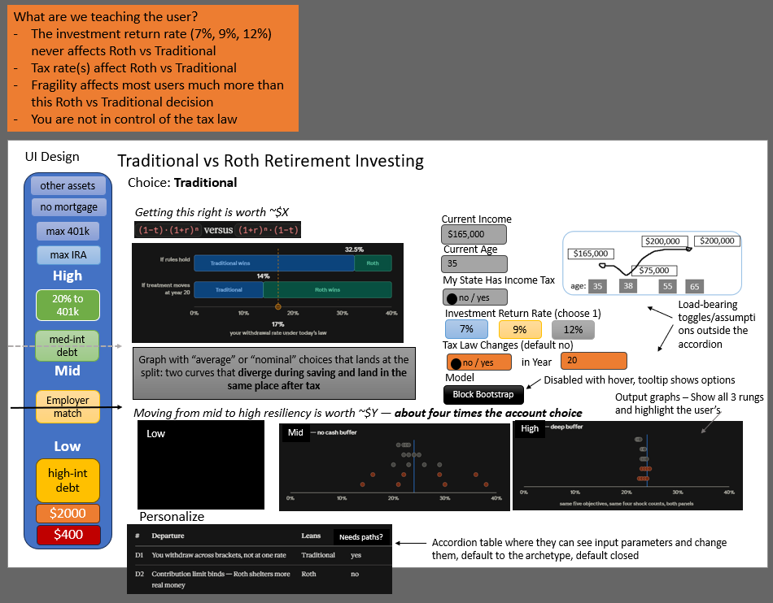

# DECISIONS

Status: **design gate two closed.** This file is the build contract.

---

## Changelog — Gate 2

Twenty-six defects found. Twenty-three resolved here, three were decisions and
are recorded as such. Numbers in this file are now reproduced from a working
deterministic engine rather than asserted.

| # | Was | Now | What it breaks if you skip it |
|---|---|---|---|
| C1 | D-33 appeared **twice** with different ladders and different bands | One D-33. Flowchart ladder, Low 1–3 / Mid 4–6 / High 7–10 | Sprint 7 has no ladder to wire |
| C2 | D-32 gave **six** checkboxes; D-37 and Sprint 7 assumed **ten** | Ten stops, ten checkboxes, defaults 1–6 on | The archetype cannot reach Mid — contiguity breaks at stop 1 |
| C3 | `t_now` was **24%** in D-19/D-24/D-25 and **32.5%** in D-18/D-30 | 32.5% is live. D-24 relabeled *federal only* | Three dollar figures and both headline numbers |
| C4 | D-25's $18,620 / $32,237 / "$763 spare" computed at 24% | Recomputed at 32.5%. **T3 moves to a $185,000 test profile** | T3's premise is false at the archetype — capacity $33,000 vs $36,296 needed |
| C5 | D-19 gave the income shape's *shape* but no **values** | Four points in D-19, linear interpolation stated | The marker is unreproducible from this file |
| C6 | D-28's 80% replacement **bankrupts both accounts** — Roth at 79, Traditional at 92 | D-28 rewritten: the draw is sized off the Roth (D-39) | Objective 1 returns $0 = $0 and the base case has no crossing |
| C7 | The year-20 toggle was specified to **flip the verdict to Roth** | It cannot. The threshold moves *right*, to 58.4%. See D-40 | Sprint 2 and Sprint 6 both had unpassable done-whens |
| C8 | No **shock magnitude** anywhere in any document | D-39: $40,000 real | Sprint 3 cannot run at all |
| C9 | §5 held **one** `roth_dollars`/`trad_dollars` pair; D-17 needs two δ | `dollars` keyed by δ | Sprint 4's cross-δ invariant is uncheckable |
| C10 | No **absorbing-floor** rule | D-38: no clamp. Ruin is a flag | The terminal difference stops being monotone and D-22's gate can't hold |
| C11 | `seed`, `n_paths`, return series all unspecified | D-41 | The cube is not reproducible |
| C12 | 8.5% state rate and the 10% penalty had no home | Both in `tax.py`, per D-21 | Sprint 1's "no tax number elsewhere" rule was unsatisfiable |
| C13 | Return buttons were **7/10/12** in §1 and README, **7/9/12** in D-04a | 7 / 9 / 12 everywhere | — |
| C14 | DoD said "the **four** tests in §6"; §6 has eight | Eight | — |
| C15 | §8 budget (130) and remaining-sprints (160) disagreed, with different cut lists | One table, in remaining-sprints. §8 points at it | Two different cut #1s, one of which deletes L1's only gesture |
| C16 | §7 caption said the mockup shows **8 rungs** | It shows ten, correctly banded | — |
| C17 | §0's DESIGN.md grid-column row superseded nothing | Deleted | — |
| C18 | README carried five stale numbers the panel would read | Propagated | §0 calls these defects, not notes |

**The three that were decisions, not defects:**

1. **The flip.** Kept, reversed, and moved to a preset. See D-40.
2. **The draw rule.** Sized to what the Roth sustains. The published marker moves from ~17% to **15.2%**. See D-39.
3. **The return series.** Stubbed for Sprints 1–2; real series is a gate on Sprint 3. See D-41.

---

## 0. Precedence

Where this file and `CONTEXT.md` disagree, **this file wins.** `CONTEXT.md` is
the tradeoff reference — it records the option space that was considered, and its
option tables carry two marker sets: `← initial pick` for the choice made during
synthesis, `← design-phase pick` for what survived design.

`README.md` is a working surface, not a source. It is reconciled against this
file at each gate — so between gates it may disagree, and this file wins by
default. **Except** where the README states a number or a claim the panel will
read, in which case the disagreement is a defect and gets fixed in the same pass.

`remaining-sprints.md` is a **source, not a working surface — but only for the
budget table and the cut ladder**, both of which §8 delegates to it. On anything
else this file wins. Gate two's HoH correction landed in D-21 and in `tax.py` and
did *not* land in Sprint 1's goal paragraph, where it then propagated forward into
a sprint brief. That gap is what this row closes.

`TRADEOFFS.md` is a **compressed restatement, not a source.** It reorganizes the
option space against the brief's own Focus and Evaluation language so it can be
read aloud. It restates rather than links because a presentation touchpoint that
sends the reader to another file is not a touchpoint. **This file wins over it,
and `CONTEXT.md` holds the fuller design-phase framing it was compressed from.**
Where a compression drops a qualification that changes an answer, that is a
defect and gets fixed here first.

`ENGINE.md` is the **numerical specification** — the engine's contract, the five
choices that change an answer, the return series, the shock branches, the cube
and the tests. It is where the README's PoC essay went. This file still wins:
§5 holds the contract and §6 holds the eight engine tests, and `ENGINE.md`
explains them rather than defining them. **One exception worth naming:** the
block-vs-IID measurement lives there in full, and D-05 carries the summary. If
those two ever disagree, the measurement is the fact and D-05 is the stale copy.

`RESULTS.md` holds **measurements a decision cites** — the run behind a number,
kept separately from the number. This file still wins on what was DECIDED, and
`RESULTS.md` wins on what was MEASURED: if D-51 and the plateau walk ever
disagree, the walk is the fact and the decision row is the stale copy. Same
exemption `ENGINE.md` already carries for the block-vs-IID table, and the same
rule `scripts/measure_*.py` exists to enforce — a published figure keeps its
source. **Nothing in it is a contract and nothing plans a sprint.**
*(This paragraph named `EVIDENCE.md` until Sprint 6. That file was created at
Sprint 4B and folded into `RESULTS.md` three commits later; the pointer outlived
it in four places and the README linked it twice.)*

`DESIGN.md` is the **design rationale and the mockup gallery.** The five `*.PNG`
files now live there with captions saying what each one decides and what moved
afterwards. It is still a working surface and this file still wins — §7 remains
the layout contract — but the deck is no longer loose: a mockup that disagrees
with a decision now disagrees *in writing, next to the decision*, rather than
inside an image nobody opened.

Design deck (`*.PNG`) — working surface, captioned in `DESIGN.md` part 3. This
file wins. Where the deck carries a number that exists nowhere else, that number
gets promoted into a decision rather than left in an image. **Two have not been
promoted and are labeled design-phase estimates in the gallery:** the income
shape's *"ending at $200k costs Traditional 1.4 points"*, and the layout's *"$Y —
about four times the account choice."* Neither is verifiable before Sprints 2 and
4, and Sprint 4's third gate warns `$Y` may land near `$X`.

Conflicts that markers can't express:

| Says | Superseded by |
|---|---|
| CONTEXT part B — PoC is "deliberately throwaway" | D-11. The PoC *is* the engine `app.py` imports |
| CONTEXT part B — "Cost in the budget" includes research and design | §8. Both are outside the implementation budget |
| CONTEXT part G3 — model the employer match | D8 disposition. Grayed, `TODO` |
| CONTEXT part D — app buttons are 7 / 10 / 12 | D-04a. 7 / 9 / 12, all real |
| DESIGN.md — rung slider, 8–10 stops, feeding shock *severity* | D-16. Three rungs; the rung selects a *mechanism* |
| DESIGN.md — tail visual "Pick 3, with 2 under it" | Cut. The $X/$Y sentence survives; the two-bar chart is a Scope & Branches row |
| DESIGN.md — "Recommended output stack ≈ 75 min" | §8 |
| DESIGN.md — the nine-stop resilience ladder | D-33. The ten-stop flowchart ladder replaces it |
| DESIGN.md — flat file of design-phase notes | Restructured into four parts: insight, model, interface gallery, gate-two reversals. All superseded text and its banners are preserved |
| README — the PoC/engine essay | Moved to `ENGINE.md`. README is now a standard repo README |
| README — the four-lesson prose | Moved to `DESIGN.md`. The L1 identity stays in the README because it is five lines and everything rests on it |
| Deck `withdrawal-rate-graphic` — second threshold at 14%, Roth wins | D-40. It is 58.4%, and the verdict does not flip at the archetype |
| Deck `accordion-input` D7 — "all tax benefits go away" | D-09. Roth only. Traditional needs no branch, and that absence is the asymmetry |
| Deck `fragility-graph` — "Rung 2", "Rung 3", eight rungs, 160 floats | D-16. Three rungs, named never numbered, 48 cells |

---

## 1. What the user learns

Four lessons. Every control on the page exists to deliver one. If a feature
can't be traced to a row here, cut it.

| # | Lesson | Delivered by | Mechanism |
|---|---|---|---|
| L1 | The return rate never affects Roth vs. Traditional | **7 / 9 / 12%** buttons | The knob that doesn't work. Balance graph swings, headline number does not |
| L2 | Tax rates do affect it | Income shape, state toggles, the accordion | Headline number moves |
| L3 | Fragility matters more than this decision, for most users | Rung control → three-panel dot plot; the $X/$Y sentence | Dots collapse as the rung rises. Dollar sentence puts both effects in one unit |
| L4 | You are not in control of the tax law | "Nevermind" toggle + the early-career preset | Roth's bet is named as a bet, and priced |

**L1 and L2 are taught by contrast.** The return-rate buttons sit physically
beside the tax controls. One moves the answer, one can't.

---

## 2. Definition of done

Shipped when all eight exist:

1. `tax.py` — 2026 brackets, deferral limit, state rate, early-withdrawal penalty. One module, source comments
2. `engine.py` — pure functions, no Streamlit import
3. `spike_grid.py` — CLI; writes `cube.json` and prints the markdown grid
4. `test_engine.py` — **the eight tests in §6**
5. `tests/test_tax.py` — **Sprint 1's assertions**, listed in that sprint's done-when. Not among §6's eight, which are engine tests
6. `app.py` — Streamlit, layout per §7
7. Deployed, reachable by URL
8. `## Scope & Branches` in README — Cut / Why / What-it-would-take

Not done, and labeled as such in the UI: historical sequence replay, a real
spending model, RMDs, Social Security, real per-state tax data, the employer
match.

---

## 3. Decisions

### Conventions

| ID | Decision | Why |
|---|---|---|
| D-01 | **Contribution convention: same pre-tax dollars.** $X to Traditional vs. $X·(1−`t_now`) to Roth | The identity is exact only under this convention, so L1 depends on it. Same-nominal-dollars silently favors Roth — that is the G4 trap. Name the convention in one sentence in the app |
| D-02 | **Wash band: ±2 percentage points.** Inside it the headline reads "It's a wash"; outside it names the winner | The headline is the sentence the app exists to print. At the archetype the gap is 17.3 points, so the band is not load-bearing there — it exists for the profiles a panelist will type in |
| D-03 | **Income shape is independent of the resilience rung.** The user sets both | Superseded reason — see D-31. The conclusion stands on the stronger argument: income is a fourth instrument ladder, and same income / different fragility is the entire project |

### Model

| ID | Decision | Why |
|---|---|---|
| D-04a | **Return buttons are 7 / 9 / 12%, all real.** Default 7%. Each labeled with its nominal equivalent; 12% is labeled implausible on purpose | D-27 puts the model in real dollars, so nominal buttons would misread. 7 and 10 collapse under conversion — 10% nominal *is* ~7% real — so a straight translation loses a button. The implausible button is the one a skeptic reaches for first, and watching `t*` hold still there is L1 at full force. Caption: *this input drives the picture, not the answer.* **Supersedes D-04** |
| D-05 | **Block bootstrap over a historical real return series. Block length 5.** Shocks placed into each path's worst accumulation years by drawdown `argsort`. **The reason for this pick was measured at gate two and did not hold; the pick survives on a different one** | Block length 5 keeps history's own bad sequences intact as sequences — 1929–32, 1937–41, 1973–74 arrive as units, and the median path's worst five-year run lands at −10.28% annualized against history's own −10.26%. **THE NUMBER REPRODUCES AND THE CLAUSE THIS ROW USED TO ATTACH TO IT DOES NOT** — it read *which is exactly 1937–41*, and only 12.6% of paths draw that block. The median path's worst run is a rolling window straddling two drawn blocks that happens to score the same depth; read strictly to the drawn blocks it is −7.27%, which is 1973–77. Corrected at Sprint 3A, same treatment as the failed reason below. **What block does not do is fatten the tail.** Measured against an IID draw on the same series, `path-drawdown` (D-44) over the 30-year accumulation window: p10 −59.6% against −63.7%, and median −42.2% against −42.0%. **THE p10 ROW CARRIES THE FINDING AND THE MEDIAN ROW DOES NOT.** Across five seeds the p10 pair says block-thinner five times out of five; the median pair splits three to two at a few tenths of a point, which is noise. Block is the *thinner*-tailed, more conservative model here, which is the opposite of what this decision originally claimed. One number explains it — the lag-1 autocorrelation of annual US real returns is **−0.035**, so at annual frequency there is no persistence to preserve, and the crashes in this record came packaged with their own rebounds (1931 sits in a block with 1933, 1974 with 1975, 2008 with 2009). **The forced-liquidation mechanism survives through a different channel:** a Low-rung shock sells $40,000 at a depressed price and the cost is the compounding forgone, so a *faster* rebound makes that cost larger. Measured, the year after the worst year returns +17.0% under block against +9.5% under IID. Block length remains a stated fudge factor with sensitivity at 3 and 10 in Scope & Branches, and `argsort` placement still means no correlation coefficient to calibrate or defend. **This row is the project's own methodology applied to itself** — a named fudge factor got measured, its justification failed, and the failure is written down rather than the reason quietly rewritten |
| D-43 | **The three parameters D-05 left open, decided at Sprint 3A BEFORE the first array existed.** Generator: **`np.random.RandomState(20260815)` — MT19937.** Sampling: **overlapping starts drawn uniformly over `[0, N−5]`, NO WRAP** — 94 distinct blocks. Trailing block: **truncated** | **The generator is chosen AGAINST current numpy practice and the reason is a product reason.** NEP 19 freezes the legacy stream permanently and explicitly declines to freeze `default_rng`, which may change its stream in a minor release. D-41 requires the cube byte-reproducible **from its header** — from an integer, by a reader who has neither this environment nor its lockfile — and only the frozen stream delivers that. The modern generator is the faster and the *less* reproducible one, and nothing here is performance-bound: this project exists to show a product effect, so a production-grade engine is not the deliverable and reproducibility outranks speed. **Overlapping starts** give 94 blocks against a fixed partition's 19, and are the only scheme that can emit 1937–41 at all — deck index 9 is not a multiple of 5, so a partition anchored at 1928 cannot produce the run two documents publish, and its worst reachable block is −7.72%. **No wrap** was refused for the mirror reason: it would manufacture a 2025 → 1928 adjacency that never happened. The cost is accepted and named — edge years appear in fewer windows, so the oldest and most recent years are undersampled. **Truncation** is stated rather than left to a coincidence: 30 and 65 years are 6 and 13 whole blocks, but `current_age = 36` gives 64, which is 12.8 |
| D-44 | **Drawdown vocabulary. Three quantities shared one word and two of them are not the same quantity.** `path-drawdown` — deepest peak-to-trough decline of the cumulative return index, **one per path**. `underwater-depth` — how far below its running peak the index sits at the end of a year, **one per year**. `worst-year-return` — the annual real return itself, **one per year** | Written at 3A because 3A and 3B both need the word and mean different things by it. **`path-drawdown` is 3A's** and is what −42.6% is; `engine.path_drawdown()` implements it. **The other two are 3B's**, and D-08's placement rule admits either — that ambiguity is 3B's to resolve and 3A does not resolve it here. The relation is the definition and is asserted in the suite: **`path-drawdown = min(underwater-depth)` over the window**, which is what keeps 3B from inventing a second, subtly different underwater curve. **`worst-year-return` drops the word entirely** — reading (a) was never a drawdown, and calling it one is most of why D-08 reads two ways. Grep behaviour is part of the pick: three distinct tokens, no shared prefix, so `grep drawdown` minus `path-drawdown` returns a small knowable set. **`path-drawdown` is computed on the return index, never on an account balance** — contributions arrive every year and buy at the bottom, masking the decline they are supposed to measure |
| D-45 | **D-08's "deepest drawdown years" means `underwater-depth`, decided at Sprint 3B BEFORE the first branch.** `engine.underwater_depth()` implements it: how far below its running peak the index sits at the end of each year. **Not `worst-year-return`, and not `path-drawdown`** | D-44 named two candidates and D-08 admits either. **They are not close:** on the published block array at 3 shocks the two readings agree on the year set for **8.1% of paths** (56.9% at 1 shock, 24.4% at 2), so this was load-bearing rather than cosmetic. Three reasons, all measured rather than argued. **It is the reading that carries the word honestly** — `worst-year-return` was never a drawdown, and D-44 says calling it one is most of why D-08 read two ways. **Year 0 becomes structurally unshockable**: the index at year 0 is its own running peak, so the curve is exactly 0.0 there on every path, where `worst-year-return` placed 3.2% of its shocks in the year cumulative Roth basis is one contribution against a $40,000 sale. **It puts a quarter as many shocks where basis is short** — 5.05% of paths take at least one such shock against 19.20%, which is why D-16's basis simplification is a small stated assumption here and would have been a large one under the other reading. **Two channels carry the difference into dollars and they partly offset:** `underwater-depth` shocks later years (mean age 51.0 against 49.2, so less compounding left to forgo) but harder ones (mean next-year return **+18.66%** against +12.63%, which is D-05's surviving recovery channel), and the mean forgone multiple lands within half a percent. **The year sets differ; the aggregate barely does** — that is a real finding and it is recorded rather than smoothed. **ALL SIX FIGURES IN THIS ROW NOW REPRODUCE**, measured by `scripts/measure_3b.py` §4 at the RESULTS.md pass: agreement 8.1% / 56.9% / 24.4%, the year-0 share, the basis-short pair, both channels, and the aggregate at 5.0550× against 5.0326× — 0.44% apart. Until then every one of them was prose in three documents with no runnable source. **Consequence, and it is not a decision:** `underwater_depth()` became a real function and 3A's `test_path_drawdown_is_the_minimum_of_the_underwater_curve` now imports it instead of recomputing the curve inline, which is the whole reason 3A wrote that assertion. The two bodies stay separate on purpose — deriving one from the other is bit-exact and asserts nothing, which is Sprint 2A's identity lesson. **And one property that is free: DETERMINISTIC MODE IS PLACEMENT-INDEPENDENT.** On a constant array every year of the underwater curve is exactly 0.0 and every annual return is one repeated value, so both candidate readings resolve through D-46 to the same year set. The headline cannot move on a choice that belongs to a cube axis |
| D-46 | **The `argsort` tie-break is `kind="stable"`, which means THE EARLIER YEAR — named, not inherited.** Recorded at Sprint 3B. **CORRECTION: numpy's default `argsort` is NOT stable.** Two documents said it was | Reproducibility is D-07's contract rather than a nicety. The default is introsort; `remaining-sprints`' 3B table and the sprint brief both read *`argsort`'s default is stable but unstated*, and the second half was right while the first was not. **This is not academic, because ties are ordinary here** — a path is dealt from a 98-value deck, so **80.8% of paths carry a duplicate annual return inside the 30-year window and 99.75% carry a duplicate underwater depth.** An exact tie at the n=3 boundary occurs on 3.15% of paths under `underwater-depth` and 12.85% under `worst-year-return`, and default-versus-stable picks a **different shock year** on **1.55% and 7.80%** of paths respectively. **CORRECTED AT THE RESULTS.md PASS, and the original pair is preserved because the correction runs AGAINST this decision.** 2.25% and 11.00% reproduce exactly — as the ORDER comparison, on the raw `argsort` slice before the sort `shock_years()` applies. That counts a permutation of the same three years as a difference, and **the engine cannot see it**: `shock_years()` returns `tuple(sorted(picks))`, so a reordering is discarded one line later and no cell can move. The ORDER figure is an upper bound; the SET figure is the exposure, and it is about a third smaller. **The argument is unaffected** — 1.55% of 2,000 paths is 31 paths, and D-07's reproducibility is binary rather than proportional. **Not a version effect**: numpy 2.4.2 and 2.4.4 return identical figures in every column. Measured by `scripts/measure_3b.py` §5, which prints both columns permanently so the distinction cannot collapse again. Introsort is deterministic on one build and is **not frozen across numpy versions**, which is precisely the exposure D-43 chose MT19937 to close — the same argument arriving one sprint later against a different library default. **The earlier year is also the conservative reading**, since an earlier shock has more compounding left to forgo: two facts for one flag, and the property is asserted in the suite rather than trusted to the flag |
| D-47 | **Low's gross-up base is `income(age) − contribution`, not gross income.** Recorded at Sprint 3B, against D-16's PIN as literally written | D-16 pins the incremental bill as `tax_on(income(age) + W) − tax_on(income(age))`. **That year's deferral already came off the top** — which is the same fact `t_now` itself is computed from, since `deferral_rate` is `(tax_on(gross) − tax_on(gross − contribution)) / contribution` — so a withdrawal stacks on what is left rather than on the whole. **Measured: it is worth 0.1% to 5.8% of the sale across the archetype's ages** *(published as 2.4% to 5.5% until the RESULTS.md pass, which measured all thirty ages instead of the ones that had been looked at — the low end is near zero at age 48, where the sale sits inside one band under both bases, and the high end is 5.8% at age 55. This file's own enumerate-by-grep rule, pointed at a loop.)*, and at the age-55 peak it is the difference between the sale crossing the 32% edge (taxable $262,180) and not ($233,360). Over 2,000 paths at 3 shocks it overstates the value at 65 of the forced sales by **$22,936 mean — 1.46% of the `trad_65` a shocked saver actually holds, or 1.09% of the deterministic $2,108,867** *(the numerator reproduces to the dollar; the published 1.09% divided this stochastic Low-with-three-shocks figure by the deterministic headline balance, which is a different population. Both are printed by `scripts/measure_3b.py` §6, and 1.46% is the one this row's own sentence is about.)* — roughly 1.4 points of `t*` read proportionally against D-16's own published lever. **The direction is what makes it worth a decision rather than a footnote:** the unfixed reading OVERSTATES Low's penalty, which is the direction that flatters this project's own lesson about fragility, and that is the failure mode D-05 exists to name. **The fix costs one line and no published figure moves** — D-16 publishes `t*` for the three FLAT readings only, and the exact method is *a fourth value* with no number attached. `contributions()` is already called in the accumulation loop at that exact year, so the base is in hand. The subtraction lives inside `forced_sale_gross()` so no call site can forget it |
| D-48 | **The uncorrelated toggle is a MODULE CONSTANT, `engine.SHOCK_PLACEMENT`, and `_accumulations()`'s cache key carries it.** So does `SHOCK_AMOUNT`. Recorded at Sprint 3B | It could not be a parameter: §5 publishes `accumulate(profile, path, shocks=0)` and 2A's 54 tests sit on that signature, which is the whole reason 2B pinned the interface early. A field on `Profile` would have been cache-safe for free — `Profile` is frozen and hashable, so it enters the key — but `Profile`'s own contract is *everything the user sets*, and the toggle is an experimenter's switch rather than a user's. **THE CACHE KEY IS THE PRICE AND IT IS WORTH STATING, BECAUSE NOTHING IN THE CORPUS ASKED FOR IT.** `_accumulations()` is keyed on `(profile, shocks, paths)`; a module constant is invisible to that key, so **flipping the toggle would have returned the correlated run's accumulations to the uncorrelated run** — silently, in the one experiment whose published sentence ENGINE.md puts at stake, producing two identical numbers and a confident wrong finding. The key now carries every module constant the accumulation reads: `SHOCK_PLACEMENT` and `SHOCK_AMOUNT`, the latter for the same reason at the $25,000/$80,000 sensitivity run. **`_DRAW_CACHE` needs no widening** — D-39 sizes the draw shock-free, so neither constant can reach it. **A related late-binding trap is closed at the same place:** a Python default argument binds at definition time, so `forced_sale_gross(..., net_amount=SHOCK_AMOUNT)` would have moved only the Roth side of the sensitivity run. `accumulate()` passes the constant explicitly |
| D-06 | **`optimal` is a parameter, not a choice. FOUR objectives ship as grid rows.** Objective 2, max after-tax lifetime spending, is **CUT** | Same inputs, swap the objective, watch the recommendation flip. That is still the demo. **Objective 2's precondition is gone:** `DESIGN.md`'s bad-at column for it read *needs a spending model*, and D-39 made spending a fixed common input, which deleted the thing the objective measured. Under a common draw and D-38's no-clamping rule, both accounts pay the same amount every year on every path *including ruined ones* — so lifetime spending is `35 × S` for both and the difference is **identically zero, at every `t_later`, every rung, every shock count.** Not small. Zero. Bisection has nothing to bracket. **Both repairs fail.** Spending-until-first-shortfall is a step function and is still degenerate at Mid and High. Maximum-sustainable-spending is *algebraically the same test as objective 1* — `S*_T > S*_R ⟺ trad₆₅(1−t_later) > roth₆₅`, the compounding factor and the annuity factor dividing out — so it can never produce a different row at any cell, verified including at Low where nothing is proportional. **This is a gate-two regression, recorded rather than quietly dropped:** D-39 changed a precondition and the objective ladder was not re-checked against it. Scope & Branches carries the row |
| D-07 | **Common random numbers.** Draw the `(n_paths, n_years)` array once; reuse across every cell, both choices, every bisection step | The quantity of interest is a small difference between two large numbers. Pairing removes sampling noise from that difference, makes the cube reproducible from a seed, and makes 48 cells cheap |
| D-08 | **Shock columns are a count (0–3); shock *timing* is correlated with drawdown.** Correlated is the default; an uncorrelated toggle exists for contrast. Shocks land in the **accumulation phase only** (ages 35–64), placed at the `n` deepest drawdown years of each path | Forced liquidation lands when prices are worst. Restricting to accumulation is not a simplification of convenience: all three rung mechanisms are defined on a contribution stream, and Mid's "contributions pause" has nothing to pause after 65 |
| D-09 | **Policy scenario is "nevermind," prospective and Roth-only.** After year N (default 20), Roth withdrawals above the frozen allowance are ordinary income. Traditional is unchanged | Simpler than a haircut: no rate parameter. Prospective is what actually tends to happen when rules move. The deck said "all tax benefits go away"; making it symmetric would delete the asymmetry that D-26 depends on |
| D-10 | **Both thresholds display, always.** The headline holds `t*` under current rules and `t*` with the nevermind policy applied. Labeled: *Roth bets the treatment holds. Traditional bets the rates do. Neither is the neutral choice — pick which rule you'd rather be exposed to* | The toggle as originally specified showed only Roth's exposure while the offsetting case sat in a README branch nobody at a demo will read. The correction costs one extra `breakeven()` call, because the bracket-rise case is *already on the axis*: a higher future rate is a position to the right of `t*` |

### Architecture

| ID | Decision | Why |
|---|---|---|
| D-11 | **One engine module, two entry points.** `spike_grid.py` and `app.py` both import `engine.py`. No duplicated math | The PoC is not throwaway. It is a script that imports a module and prints a table |
| D-49 | **Sprint 4A's invariants live in `spike_grid.validate_cube(cube)`, and its `--check` flag re-runs them against a committed `cube.json`.** *(SIGNATURE, as shipped: `validate_cube(cube, paths=None)` — D-51 widened it and this row was never updated. Added at Sprint 4B, which called it from a row that published the narrower form.)* Recorded at the Sprint 3B docs pass BEFORE the first cell. **The invariants split by operand and the split is the decision, not a detail.** Properties of the cube AS DATA — 48 cells against §5, the 36-cell slab, `dollars` keyed off `status`, `roth != trad` within each δ, Roth identical across δ, a surviving non-crossing cell, `ruin` populated — go in `validate_cube()`, which takes a dict, so `spike_grid` calls it on the in-memory cube before the write and `--check` loads the file and calls the same function. Properties of THE RUN — two runs byte-identical, runtime — are a two-command recipe, not an assertion, because neither is visible from inside one run. The property of the SOURCE FILE — `spike_grid` contains no math (D-11) — is a review item. FINDINGS go to `scripts/measure_4a.py`. **The Roth-across-δ assert is free because `policy` is null on every cell**; under D-26's branch Roth's terminal does depend on `t_later`, so that assertion becomes wrong the day `policy` enters the cube | 4A's own seam forbids it opening `tests/test_engine.py`, so the sprint that writes the cube cannot write the test that guards it. `_selftest()` is this repo's answer to that shape and it has been used twice — `engine.py` and `return_series.py`, both for one command, no test runner, fails loudly. **`spike_grid.py` is Definition of Done item 3, so the validator adds no artifact.** Lumping all ten invariants into one home is what made this look hard; they have four operands and three of them are not the cube. **Sprint 4B may wire one call into `tests/test_engine.py`**, which it owns and 4A may not touch — that is the follow-on, and it costs 4B's *this sprint writes no tests* line |
| D-12 | **The app contains no stochastic code.** It reads `cube.json` | Deploys smaller, cannot be slow in front of a panel, no seed in production |
| D-14 | **The cube is computed at the reference archetype, not at the user's profile** | It is precomputed. Consequence in D-15 |
| D-15 | **User inputs move the vertical line, not the dots.** The dot plot is labeled *modeled for the reference profile*. **Two different mismatches separate the line from the dots, and only one of them is a labeling problem** | The interaction still lands — set the state toggle and the line slides through the cloud — but the app must not imply the dots are personalized. **Profile mismatch:** the line is the user's, the dots are the archetype's. That is what the label fixes. **Return-model mismatch:** the line is deterministic at 7% real (D-04a) while the dots come from a bootstrap whose mean path compounds at **6.78%** — the historical series' own geometric mean, which `return_series.py` forbids rescaling. **This does not move `t*`.** The scalar multiple holds per path, so the 0-shock slab lands on `t_now` at any return rate; that is T2 and D-22's validation gate, and it is why L1 survives the mismatch untouched. **It moves dollars.** So a reviewer comparing a figure on the balance graph against a figure in the $X/$Y sentence will find them a few points apart, and the answer is that they are computed on different return models deliberately. Label it where the dollar sentence lives. Do not close the gap by editing the series. **RESTORED in Sprint 2A: the deterministic proxy at the series' own geometric mean puts T65 at $2,028,066 against $2,108,867 at 7%, a 3.83% gap.** That is a proxy, not the bootstrap. **SPRINT 3A MEASURED THE REAL DISTRIBUTION and it is in the subsection below, which is the one place it lives.** **Sprint 6's caption carries the MEDIAN, $2,123,538** — decided by Nicole 8/18, reasons in the subsection |
| D-22 | **Deterministic mode is `paths` of shape `(1, n_years)` filled with the constant real return.** `make_paths(kind, ...)` builds either a constant array or a bootstrap array; the engine cannot tell which it received. **Supersedes D-13** | The block bootstrap has no `sigma` — that parameter belonged to the parametric model D-05 rejected. Expressing the deterministic path as a shape rather than a setting makes D-13's claim structural: one function, one code path, nothing to drift. Two consequences: at `n_paths=1` objectives 1, 3 and 4 collapse, so the headline is objective-independent by construction; and objective 5 degenerates to a step function that will not bisect, so the deterministic path must reject it. **Validation gate, and it is DERIVABLE rather than measured — see the note below** |
| D-38 | **The engine never clamps a balance at zero.** Balances are allowed to go negative; ruin is a recorded boolean, not an absorbing floor | Objectives 1–3 bisect on the *difference* between two terminal values. That difference is monotone in `t_later` and crosses zero at `t_now` — but only if the arithmetic is allowed to run. Clamping makes both sides pile up at $0 over a range of rates, the difference goes flat, and bisection returns whichever endpoint it started nearest. D-22's gate cannot hold with a floor in the code. Objectives 4 and 5 read the flag; nobody reads a clamped balance. **This extends to the D-26 bequest, and that is the one place a clamp looks like tax logic rather than a floor** — see D-26's subsection, where it is the difference between a headline and a sentinel |
| D-51 | **The 36-cell slab check is TWO assertions over two operands, not one over 36 cells.** Recorded at the Sprint 4A assessment BEFORE the first cell. **Objectives 1, 3 and 4 — 27 cells — assert `breakeven` within `128` ulps of `t_now`**, the `T2C_ULP_K` bound 2C already set for this tension, restated as a literal with its citation in the assert message because `tests/test_engine.py` holds the constant and 4A may not open it. Measured worst at 4A: **9 ulps.** **Objective 5 — 9 cells — asserts nothing about `breakeven` at all.** It asserts D-22's actual claim instead: `outcome(trad) − outcome(roth) == 0.0` at `t_now`, **exactly, no tolerance**. Verified bit-exact on all nine. `breakeven` on those cells is a plateau EDGE and ships as-is with a caption. **`validate_cube(cube, paths=None)` rebuilds the path array from the header when `paths` is None**, which widens D-49 | The done-when said *equal `t_now` exactly* and *assert as an identity, not a tolerance*, and the two clauses point at different operands. **D-22's exact identity is `roth/trad`, an accumulation ratio, asserted bit-exact at 3B inside 4 ULP. The slab check reads `breakeven()`'s output, which is a SOLVER RESULT** and stops at float exhaustion (2C), so it cannot be bit-exact and 2C said so in writing. **Objective 5 is worse than imprecise, it is a different shape.** `P(not running out)` counts a discrete event over `n_paths`, so its difference is a STAIRCASE with step `1/n_paths` and its zero set has WIDTH — measured **[0.324218, 0.325834], 0.1616 pp**, with `t_now` sitting 48.4% of the way across. `breakeven()` tests `(f_mid > 0.0) == (f_lo > 0.0)`, an exact zero reads as *not positive*, and the interval closes on the plateau's LEFT edge every time: **0.0782 pp below `t_now`, deterministically.** D-22 already knows this shape and scopes it one size too small — it says objective 5 *will not bisect* and attaches that to `n_paths = 1`. At 2,000 paths the staircase does not vanish, it grows 2,000 steps. No bound on `breakeven` is honest at any width, because it would be sized against a sampling artifact that shrinks with `n_paths`. **The split is D-49's own reasoning one level down: invariants have operands.** The widening of D-49 costs a pure-data function and ~5 s on `--check`; it buys the first code in this repo that actually verifies `paths_digest` |
| D-52 | **`constants_fingerprint` is a blake2b-128 digest over a DECLARED, sorted list of `name=repr(value)` lines — seven `engine` module constants plus two derived probes — and the declared list IS the decision.** Constants: `BRACKET`, `POLICY_YEAR`, `RETIREMENT_AGE`, `ROTH_TERMINAL_MARGIN`, `SHOCK_AMOUNT`, `SHOCK_PLACEMENT`, `TERMINAL_AGE`. Probes: `archetype.t_now` and `forced_sale_gross()` at age 55. **`SEED`, `N_PATHS` and `BLOCK_LENGTH` are EXCLUDED — `paths_digest` covers them** and the two fields are meant to be disjoint; `SAVINGS_RATE` is excluded because the header's `profile` block serializes it. **`spike_grid.py` does not import `tax`.** Value at the current constants: `c00a62111fef4a93d5eaee2377420afb`. **SIGNATURE: `constants_fingerprint()` — no arguments, and that is the point of it.** Its inputs are entirely module-level, so no caller can pin the wrong thing by passing the wrong thing. *(This row described the recipe in full and never named the call. Sprint 4B had to wire it while forbidden to open the module, found the absence, and reported it rather than reading the file — which is the escape hatch working. Added here at 4B. **`inspect.signature` is the sanctioned route:** it reads the function object's interface, not its source, and is the machine-readable form of what this row should have carried.)* | **The two probes are how `tax.py` gets covered without being read.** Every tax number that reaches a cell — the seven bracket edges, the standard deduction, the deferral cap, the state rate, the early-withdrawal penalty — is invisible to `paths_digest` and would move all 48 cells silently, which is the hole this field exists to close. Enumerating them by name means importing `tax` into a deliverable and maintaining a list that grows. Two derived floats cover the surface instead: **`t_now` moves if the brackets, the deduction, the state rate or the deferral cap move; the age-55 forced sale moves if the penalty or D-47's gross-up base moves**, and it is already a published figure ($73,959.60, the 3B self-test line). `engine.contributions()` supplies the sale's base, so no `tax` import is needed. `repr()` on a float is shortest-round-trip and stable across platforms in Python 3; blake2b is `paths_digest()`'s primitive rather than a second idiom. **THE MECHANISM IS INCOMPLETE AT 4A.** The header block's own table says *a test pins it* — and 4A cannot write that test, because `tests/test_engine.py` is its seam. Shipped unpinned the field is a string nobody compares, which reads as coverage and is not. Cleanup tag tagged at the function and added to 4B's done-when list (claude 8/20), RNU completed, tag removed (nlr 8/20) |

| D-53 | **The `validate_cube` wire runs in the default suite, unmarked and unfixtured — `validate_cube(committed_cube())`, `paths=None`.** Recorded at the Sprint 4B assessment BEFORE the wire. Cost: the suite goes **1.67 s → 4.05 s** in the agent's container, and 1.17 s → ~3.7 s on the measured local numbers | Four options were costed and three were rejected. **A session fixture supplying `paths`** saves ~0.5 s, needs `make_paths`' block signature — which D-49 and D-52 do not publish either — and invents a house pattern for one caller. **A marker excluded from the default run** buys the whole 2.4 s and sells the reason the test exists: an unpinned fingerprint *reads as coverage and is not* (D-52), and a guard nobody runs is the same object one level up. **A cheaper subset** is not reachable at 4B — skipping D-51's nine objective-5 accumulations needs a parameter on `validate_cube`, which means editing `spike_grid.py`, which 4B's seam forbids. **`paths=None` is not the slow half by accident, it is what the test buys:** D-51 widened D-49 so a None rebuilds the array from the header and checks it against `paths_digest`, and that is the only code anywhere that verifies that field. **Four seconds is not yet a constraint and this is the only test in the repo guarding the artifact the app reads.** The argument for the marker gets stronger every sprint; when the suite crosses the threshold where someone stops running it locally, this row is where to reverse |
| D-54 | **The T-table reconciliation runs against `DECISIONS.md` §6, and `ENGINE.md` carries the MAPPING.** Recorded at the Sprint 4B assessment | §0 already decides it and the sprint's own done-when treated it as open: §6 *holds the eight engine tests* and `ENGINE.md` *explains them rather than defining them*, which is exactly what a claim-to-function mapping does. **The README gets no table** — it never had one, two done-whens in `remaining-sprints.md` and one line in `tests/test_engine.py`'s module docstring asserted it did, and that is three sites rather than the two Housekeeping counted |
| D-55 | **One row per CLAIM, every function named inside it with a ROLE, and the role word opens the function's own docstring.** Roles: primary, half, teeth, mechanism, fields, guard. Recorded at the Sprint 4B assessment BEFORE the docstring pass | The backward pass returns **17 functions against 8 claims** and the relationship was never specified. **A primary/companion split is the obvious reading and it is FALSE on two rows.** T2 holds **two halves** — the draw-cancellation sweep closed at 2B and the `t*`-across-`r` solve at 2C, defending one sentence from two directions — so marking either a companion asserts something untrue about the sprint that wrote it. T4's second function defends **2C's `Result`-fields done-when**, not the proposition that T4's sentinel breaks somewhere. **T3 has one function and that is not a gap:** it is a strict inequality asserted at both bracket endpoints rather than an identity, so its teeth are in the same assertions as its claim. Putting the role in the docstring is what makes the table and the file agree by construction — the failure mode the both-directions requirement exists to catch is a table maintained by care |
| D-56 | **A docstring QUOTES its claim, and the quote is taken from whichever §6 cell states what must be true.** The other cell's citations follow the quote. Recorded at the Sprint 4B assessment | The done-when says *quotes*; the Goal said *names*, and the delta is the sprint. **§6's *Claim it defends* column is a sentence on three rows and a citation list on five** — T3's reads *D2, the G4 trap, and D-25's scoping of D-01* and T6's reads *D-16 low branch, D5, D-39*, neither of which is a sentence a test can protect. Quoting from the *Test* column on those five keeps the citation in the docstring where it already was, and keeps the quote inside §6 rather than reaching into D-16 and D2 — a quote one hop from the table it reconciles against is not diffable, which is the whole reason for quoting |
| D-57 | **The suite asserts its own size in FUNCTIONS, not collected items — 168, walked with `ast`.** `ENGINE.md` publishes both numbers and says why they differ. Recorded at the Sprint 4B assessment | Closes the Housekeeping item that had `ENGINE.md`'s count *maintained by hand in three places and right at every gate by care rather than by construction* — **four places: the README's `tests/test_engine.py` row carries a fourth copy, and §0 makes a README number the panel reads a defect rather than a lag.** The collected count (250) is the one the documents lead with and it cannot be asserted from inside a test: `request.session.items` sees the FILTERED set, so the assertion would fail under the sprint's own `-k` gate command unless it skipped itself — and a guard that skips itself is the object this item exists to remove. A `--collect-only` subprocess is exact and spawns pytest inside pytest. **`ast` is the house idiom already** — two tests parse `engine.py` this way. **Module-level only, which is complete today** because no test in this suite lives in a class, and the day one does the assertion goes red rather than quietly counting low |

### D-15 — the dollar side of the return-model mismatch  ✅ PROXY RESTORED, Sprint 2A

**What was wrong.** D-15 published the bootstrap's compounding rate as ~6.81%.
The series compounds at **6.7762%**, which is what `return_series.py` measures,
what its self-test prints, and what the README carries. The row and the file
disagreed by three basis points.

**Where 6.81% came from, because it is not a typo.** Deflate the same 98 rows by
*subtraction* — `nominal − cpi` — and the geometric mean is 6.8176%. D-27
prohibits subtraction by name and `return_series.py` implements Fisher-exact,
which is the entire reason it keeps `RAW` around. So 6.81% is a pre-D-27 number
that outlived the convention that produced it. **Recording the provenance rather
than the correction alone, on the same principle D-05 records a failed reason
rather than quietly rewriting it.**

**What is still stale, and why it is blank rather than guessed.** Two figures
were computed off 6.81% and both are downstream of an engine that does not exist
yet:

| Figure | Published | Status |
|---|---|---|
| T65 under the bootstrap | ~~$2,038,611~~ | **PROXY RESTORED: $2,028,066.** Deterministic run at the series' geometric mean, Sprint 2A. **Bootstrap distribution supplied at Sprint 3A** — p10 $997,415 (−50.8%), median $2,123,538 (+4.7%), mean $2,618,218 (+29.1%), p90 $4,748,012 (+134.1%), over 2,000 paths at `seed = 20260815`. **There is no single bootstrap value and that is the finding** — the mean and the median disagree by twenty-four points and the p10 is half the proxy |
| Dollar gap, deterministic vs. bootstrap | ~~3.4%~~ | **PROXY RESTORED: 3.83%** |
| T65 at 7% deterministic | $2,108,867 | Unaffected — not a bootstrap number |

**One precision note, and it is the reason this is computed rather than typed.**
The proxy must run at the geometric mean *the series measures*, not at the
four-decimal rounding of it. `6.7762%` as a literal returns **$2,028,055.76**;
the series' own **6.776229%** returns **$2,028,066.17**, which is the published
figure. Ten dollars, on a number that is only in this document to be checked
against — so `engine.geometric_mean(return_series.REAL_RETURNS)` is the operand,
and the rounded literal appears nowhere in code.

**Two stages, because the published figure was a proxy and nobody said so.**
$2,038,611 was a *deterministic run at the series' geometric mean*, not a
bootstrap result. Sprint 2A can reproduce that object directly — expect **T65 ≈
$2,028,066 at 6.7762%, a 3.83% gap** — and clearing this row's tag is one of its
done-whens. But the proxy and the bootstrap are not the same thing: by Jensen,
the mean of terminal values need not equal the terminal of the mean-compounding
path. **Sprint 3 checks the proxy against the real distribution and reports the
difference**, whichever way it goes.

A level-contribution stream over 30 years lands about **3.9%** below the 7% case
at 6.7762%, against 3.35% at 6.81%. That is an annuity approximation, not the
model: the archetype's contributions are `min(0.20 × income, cap)` over D-19's
four-point income shape, not a level stream. **It is here to say which direction
the correction runs and roughly how far — not to be published.** Sprint 2A's
accumulation produces the proxy (~$2,028,066, a 3.83% gap) and Sprint 3 produces
the real distribution.

**Consequence for Sprint 6.** Its done-when instructs a caption reading *dollar
figures differ by about 3.4%*. That number is withdrawn; the caption is not.
Write it from Sprint 3's output — the caption is about the bootstrap, so the
Sprint 2A proxy is not the right number to publish there. The caption's job — telling a panelist the two
return models are different on purpose — is unchanged and is still load-bearing.

**THE BOOTSTRAP DISTRIBUTION, MEASURED AT SPRINT 3A.** 2,000 paths, `seed =
20260815`, T65 Traditional, against the $2,028,066 deterministic proxy:

| | | vs. proxy |
|---|---|---|
| p10 | **$997,415** | −50.8% |
| *proxy (deterministic at 6.776%)* | *$2,028,066* | — |
| median | **$2,123,538** | +4.7% |
| mean | **$2,618,218** | +29.1% |
| p90 | **$4,748,012** | +134.1% |

**There are three answers, not two, and they disagree by more than the whole
question the model answers.** The account choice at the archetype is worth a
fraction of what the spread between the mean and the p10 is worth. Jensen is not
a footnote: the proxy compounds the *mean* rate, the distribution compounds
*sampled* rates, and the gap between mean and median is variance drag surviving
into dollars.

**DECIDED — the caption carries the MEDIAN.** The pick was Nicole's
to make and this is it; 3A brought the reading and the reasons, and they are the
reasons the pick rests on. Three, in order of weight. **D-23 already rejected expected value as a gauge, in this project's own
words, because the ensemble average is not what any one household lives** — and
the mean is that average, sitting +29.1% above the proxy on the strength of a p90
that is 2.3× the median. **The median is the one figure that is close to the
proxy** at +4.7%, so a panelist comparing the balance graph's deterministic line
against the dollar sentence finds a few points of difference and a label
explaining it, which is exactly what D-15 says the caption is for; the mean makes
that same comparison a 29-point discrepancy the caption would then have to
defend. And **the median is already an objective the cube ships** (objective 3),
so the caption cites a number the grid also contains. The counter-argument worth
having: the mean is what "expected" means to a finance-literate panelist, and
publishing the median invites *why not the mean* — which D-23's sentence answers
in one line, so the cost is a sentence rather than an argument.

### D-22 — why the collapse is derivable, and how much of the cube it covers

**One fact, applied four times.** Objectives 1, 3, 4 and 5 are all monotone
functionals of the after-tax terminal *distribution* — mean, median, 10th
percentile, `P(≥ 0)`. **Corrected at Sprint 2B: objective 5 is `P(NOT running
out)`, maximized like the other three, and `Result.ruin` is its complement.**
Written as `P(< 0)` this row named the one functional that decreases where the
others increase, and `breakeven()` needs them all pointing the same way to have
a monotone difference to bracket. When the Traditional and Roth after-tax
distributions are related by a positive scalar `(1−t_later)/(1−t_now)`, every
one of them crosses where that scalar equals 1. That is not four coincidences to be measured; it is
one property to be asserted.

**Where the multiple survives:**

| Rung | Mechanism | Multiple | Why |
|---|---|---|---|
| High | Absorbed by cash | **preserved** | Nothing is touched |
| Mid | Contribution paused | **preserved** | Removes `c` from Traditional and `c·(1−t_now)` from Roth. The paused stream scales identically |
| Low, 0 shocks | Nothing fires | **preserved** | No branch runs |
| Low, shocks ≥ 1 | Forced sale | **BROKEN** | Traditional grosses up through the penalty; Roth basis comes out free. The only asymmetric mechanism in the cube |

Measured on a constant-return path, `roth/trad` holds at `0.675000000000` for
Mid and High at 0, 1 and 3 shocks, and moves to ~~`0.689633` and `0.708591`~~
**`0.705664` and `0.855412`** at Low.

**THE MID AND HIGH FIGURE REPRODUCED AT SPRINT 3B; THE LOW PAIR DID NOT, AND THE
REASON IS IDENTIFIED RATHER THAN GUESSED.** `0.675000000000` comes back bit-for-bit
at both rungs at 0, 1, 2 and 3 shocks — that half of this row is now a test rather
than a memory. The Low pair was measured at gate two by code that is not in this
repo, **before the placement reading, the tie-break, the base and the basis rule
existed**, so all four of D-45 through D-47 move it. Searching every (shock year,
gross-up rule) pair against `0.689633`, exactly one combination lands on it to six
decimals: a **flat `t_now` gross-up with the shock at year 9**. That is the reading
D-16's PIN was written to reject, and it independently corroborates D-16's own
flat-reading table, measured in the same pass. The replacement values above come
from `scripts/measure_3b.py`, and `tests/test_engine.py` records both the new
numbers and the identification. **Stale for a known reason is a different thing
from wrong for an unknown one**, which is why the old pair is struck through here
rather than deleted.

**The direction is worth naming: Low's break is LARGER than gate two thought**, not
smaller — the exact incremental gross-up costs Traditional more than a flat `t_now`
does, so the one asymmetric mechanism in the cube is stronger than the row claimed.

**So the gate is: the entire Mid and High slabs equal `t_now` at every shock
count — 32 of 48 cells — plus Low's 0-shock row, for 36 of 48. Only 12 cells
vary.** **CORRECTED AT SPRINT 4A: *asserted exactly* holds for the CLAIM and not
for the SOLVER OUTPUT, and D-51 splits it.** Objectives 1, 3 and 4 land 1–9 ulps
off `t_now` because `breakeven()` stops at float exhaustion; objective 5 lands
0.0782 pp off because its difference is a staircase whose zero set has width.
The identity is asserted where it is exact — on the difference at `t_now` — and
the ulp bound covers the solver's representation.

**MEASURED AT SPRINT 4A, over the 48-cell cube, and this is the L3 collapse:**

| Rung | 0 shocks | 1 | 2 | 3 |
|---|---|---|---|---|
| Low, objective 4 | 32.5000% | 30.8987% | 28.0158% | 24.4070% |
| Mid, objective 4 | 32.5000% | 32.5000% | 32.5000% | 32.5000% |
| High, objective 4 | 32.5000% | 32.5000% | 32.5000% | 32.5000% |

**8.13 points of movement at Low against zero at Mid and High**, taken at the
widest objective (objective 3 and 4 agree to a tenth of a point at 3 shocks).
Source: `scripts/measure_4a.py`, finding 1. The dot panels render this as three
rows that fan out at one rung and stack at the other two — L3, shown rather than
asserted.

**This is not a defect to repair.** Giving Mid an asymmetric mechanism so the
dot panels show a gradient is exactly what this project is against. The honest
reading is sharper than the gradient would have been: *the account question is
only contested for people without a buffer.* At Mid and above, every definition
of optimal returns the same number.

**Three mechanisms break proportionality, and only one is in the cube:**

| Mechanism | Where it acts |
|---|---|
| Low's early-withdrawal penalty | The cube — the 12 informative cells |
| The "nevermind" policy | Headline only. D-26 keeps policy off the cube axes |
| **D2 ON** — Roth filled to the cap after-tax | Accordion only |

D2 is the reason T3 matters more than its position in the test list suggests: it
is the only coverage of the second asymmetric mechanism.

### D-16 — Resilience rungs

**Three rungs, not eight.** `DESIGN.md` describes three *mechanisms*; eight would
have meant inventing six intermediate severities with nothing behind them.

**The rung selects which branch of the shock code runs.** It is not a multiplier.

| Rung | What a shock does | Implementation |
|---|---|---|
| **Low** — no buffer | Forces liquidation | Sell $40,000 (D-39) at the shocked year's price. Traditional takes the 10% early-withdrawal penalty plus ordinary income; Roth basis comes out free |
| **Mid** — some buffer | Pauses contributions | No sale. Contributions stop for the shock year and resume after. The cost is the shares not bought |
| **High** — deep buffer | Absorbed by cash | Portfolio untouched. The control case |

Mid carries the argument and is the branch a reviewer opens first. Pausing
contributions during a drawdown means you stop buying at exactly the moment
prices are lowest — a real cost that appears nowhere on a statement. Low sells at
the bottom; mid fails to buy at the bottom; high does neither.

Rungs are **named in the UI, never numbered.** The ladder figure keeps all ten
stops and marks which three bands are modeled: the figure is the argument, the
three are the model.

**PIN — Low's withdrawal is taxed at the exact incremental rate, not a flat one.**
The sale must NET `SHOCK_AMOUNT` after both the 10% penalty and ordinary income
tax on the withdrawal. That tax is `tax_on(income(age) + W) − tax_on(income(age))`
— the actual incremental bill in that year — plus the state rate when the
working-state boolean is on. **The BASE in that expression was corrected to
`income(age) − contribution` by D-47 and the code implements D-47; this
sentence is left as written and the correction is four paragraphs down.** **Using `t_now` here would be D-21's error running
one direction over:** `t_now` is the rate the *contribution* avoided, in a
different year at a different income, and a withdrawal is a different event.

This is not a rounding decision. Low-with-shocks is the entire varying part of
the cube, and three flat readings of "ordinary income" span **3.5 points** of
`t*` at three shocks:

| Flat reading | `t*` |
|---|---|
| `t_now`, 32.5% combined | 29.14% |
| Federal only, 24% | 32.08% |
| Marginal rate at that year's income | 32.64% |

The exact incremental method is a fourth value and is the one to implement. It
reuses `tax.py` and adds no new tax number.

**IMPLEMENTED AT SPRINT 3B as `engine.forced_sale_gross()`, in closed form.**
`net(W)` is piecewise linear in `W` and the slope inside a band is
`1 − 0.10 − STATE_RATE − rate`, whose floor is **0.445** — strictly positive, so
net is increasing everywhere and the inverse is unique. Verified against a
300-step bisection at **8.7e-11** over 84 cases spanning every band, both state
settings and all three D-39 shock sizes. No tolerance argument and no iteration
count, the third inversion in this project to say so. It lives in `engine.py`
rather than in `tax.py`: it reads the bracket table, the deduction, the penalty
and the state rate but reaches for none of `tax.py`'s private names, and the
quantity it produces is a *model* fact — how big a sale D-16's mechanism forces
— rather than a fact about the code. `EARLY_WITHDRAWAL_PENALTY`'s own source
comment already pointed here: *first USED in Sprint 3, at the forced-liquidation
branch.* **It carries the same below-the-standard-deduction guard
`gross_for_net()` does**, for the same reachability reason — a low income gives a
low base, the app takes income as a control, and without the guard the band
arithmetic is silently wrong by $3,922 at a base of zero.

**THE BASE IS `income(age) − contribution` (D-47), not `income(age)`** — that
year's deferral already came off the top. The PIN's wording above predates that
correction and is left as written, the same treatment D-05 and D-19 get.

**THE ROTH SALE COMES OUT OF BASIS IN FULL, AND NO BASIS IS TRACKED (Sprint
3B).** *Roth basis comes out free* was silent on the case where the sale exceeds
what has been contributed, and the case is reachable: cumulative Roth basis at
the archetype does not reach $40,000 until age 37, so **5.05% of bootstrap paths
take at least one shock where it is short — and in DETERMINISTIC mode the first
shock always is**, because D-46 places it at year 1. Tracking it would put a
second asymmetric mechanism on the **Roth** side, and D-22 counts exactly one
asymmetric mechanism in the cube. The simplification is stated here rather than
discovered at Sprint 4A, and D-45's placement is the reading that makes it small.

**THE THREE FLAT READINGS ABOVE HAVE A CONFIRMED PROVENANCE, FOUND AT 3B.** D-22's
published Low ratios reproduce exactly under the **flat `t_now`** row and under no
other — see D-22's measured line. So the table was computed with the reading this
PIN rejects, which is consistent rather than alarming: it is what the table is
*for*. It also means the `t*` values in it are gate-two arithmetic, and only the
exact method's fourth value comes out of the engine.

### The archetype and the numbers that come out of it

| ID | Decision | Why |
|---|---|---|
| D-19 | **Reference archetype:** age 35, retires 65, dies 100, filing single. **Income shape, four points, linearly interpolated: (35, $165,000) · (38, $75,000) · (55, $200,000) · (65, $200,000).** Savings rate 20%. State: **taxed while working, untaxed in retirement** (D-30 defaults) | Filing single because the UI models one income curve and one age — an MFJ archetype is a household the controls cannot represent. $165k is what a Staff SWE recognizes. The trough at 38 is parental leave, which CONTEXT part E already flags as this population's low-bracket window. The end point is flat from the peak rather than declining. **THAT CHOICE'S REASON DID NOT SURVIVE MEASUREMENT, Sprint 2B.** It read *ending high is the conservative case, since it raises retirement spending and narrows Traditional's lead* — and at this archetype it does neither. The deferral cap binds on every year of the 55→65 leg under both shapes, so the two profiles return the same age-65 balances, the same $108,397 draw, the same 15.18% marker and the same 58.4064% policy threshold. The flat end point keeps the weaker claim it can support, that it asserts less than a declining one, and the failed reason is recorded rather than rewritten — the same treatment D-05 and D-15 get. DESIGN.md 3.2 and the README's `## Results` carry the measurement. **Consequence: `t_now` = 24% federal, 32.5% combined. The absence of a bracket straddle is no longer an assumption** — `deferral_rate` and `marginal_rate` agree exactly at $165,000, and `tests/test_tax.py` asserts it. See the D-21 subsection for the three incomes where they do not |
| D-20 | **Horizon runs to age 100; `n_years = 100 − current_age`.** Two phases: accumulate 35→64, decumulate 65→99. All objectives evaluate at 100. Guard on `current_age >= 65` | Planning past median longevity is the standard convention, because outliving the money is the failure that matters. Splitting the phases is what puts `t*` where it belongs — in the withdrawal years. "Terminal wealth" therefore means bequest at 100, not balance at 65. **Cash flows land at PERIOD END in both phases:** accumulation is `balance = balance × (1+r) + contribution`, so a contribution earns no return in the year it is made, and decumulation is `balance = balance × (1+r) − draw`. Stated because it is not free — the annuity-due reading puts Traditional at 65 at $2,256,487 instead of $2,108,867 (**+7.0%**) and the draw at $101,305 instead of $108,397 (**−6.5%**). Close enough to read as an interpolation bug, far enough to fail every published gate |
| D-21 | **`tax.py` implements SINGLE only:** 2026 bracket edges, seven rates, standard deduction $16,100, deferral cap $24,500, **state rate 8.5%**, **early-withdrawal penalty 10%**. MFJ and HoH are `TODO` stubs. **Over-65 deductions are DEFERRED, not omitted. `t_now` is a deferral rate, not a bracket lookup — see the subsection below** | The deduction applies to withdrawals, so gross minus deduction gives taxable and the bracket table is read in taxable terms. **The state rate and the penalty live here too**: they are tax numbers, and Sprint 1's rule is that no tax number appears anywhere else in the repo. **`tests/` is the one exemption**, stated in the module docstring, because a hand-verification that imports the constant it is verifying tests nothing. **R1 is CLOSED** — all seven single edges and the $16,100 deduction verified against IRS IR-2025-103 / Rev. Proc. 2025-32 on 2026-08-15, and corroborated by Tax Foundation's independent table. **HoH's reason changed:** the stub was justified by "overlapping edges at the 24/32 boundary," which the primary source does not support — the published HoH column is contiguous (24% ends $201,750, 32% begins $201,751). It stands on D-19's reason instead, which is the stronger one: the UI models one income curve and one age, so a household is something the controls cannot represent. **The two over-65 deductions are deferred with their cost measured** — the permanent $2,050 (IRC 63(f)) and the temporary, income-phased OBBB senior deduction of up to $6,000. Together they take the marker from 15.2% to 13.5%, which *widens* Traditional's lead, so omitting them understates the recommendation rather than inflating it. **That 13.5% carries a convention and the constants' comment must name it: the gross is RE-SOLVED to hold D-39's net draw at $108,397, falling to ~$125,380, and the $6,000 is taken IN FULL.** Holding gross fixed at $127,804 instead gives 13.7%; applying the OBBB phaseout gives ~14.1%. Neither changes a verdict; the preset's flip survives at 14.4% against a 12.0% threshold. Wiring the $2,050 is one conditional on age and is the honest one to do first; the $6,000 sunsets, and applying it across a 35-year retirement would assert something the statute does not say |
| D-25 | **D-01 applies at `min(capacity, cap)` in PRE-TAX terms.** Base case: **$24,500 to Traditional, $16,538 to Roth** — the Roth deliberately under-fills. **D2 ON** fills the Roth to $24,500 after-tax, which costs **$36,296** pre-tax | The cap is denominated in nominal contribution dollars — pre-tax for Traditional, after-tax for Roth — so at the boundary the two choice sets differ and the convention has nothing to equalize. Reading D-01 as a comparison device rather than a behavior model resolves this: the base case isolates the *timing* effect, D2 adds the *capacity* effect back as a named step. Under-filling the Roth is artificial and is labeled so in the app. **THE RULE AS CODE, since T3 needs it and no row stated it.** Let `capacity = savings_rate × income(age)`. D2 **OFF**: `trad = min(capacity, cap)` and `roth = trad × (1 − t_now)` — same pre-tax dollars, D-01. D2 **ON**: `trad` is unchanged at `min(capacity, cap)` — it cannot go higher, the cap binds — while `roth = min(cap, capacity × (1 − t_now))` in AFTER-TAX dollars. **D2 deliberately breaks D-01's same-pre-tax-dollars convention, and that break IS the asymmetric mechanism** D-22 counts alongside Low's penalty. **The unaffordable case degrades rather than raising:** at the archetype the second term binds at $22,275 against the $24,500 cap, which is D-42's lesson rendered as arithmetic instead of as an exception — the cap is denominated in dollars that cost you more, so it binds before it looks like it should |
| D-42 | **T3 runs at a `$185,000` test profile, not the archetype.** The archetype's capacity is $33,000 against the $36,296 cost of maxing the Roth — **D2 ON is unaffordable there.** $185,000 gives $37,000 of capacity and stays inside the 24% bracket after the deferral. **FULL SPEC, because "a $185,000 test profile" is not a profile:** income **FLAT at $185,000 at all four D-19 knots**, savings rate 20%, age 35, state-while-working ON and state-in-retirement OFF (the D-30 defaults), `stops` at D-32's default. **The flatness is the specification, not a convenience** — D2's affordability is tested every contribution year, and any shape with a trough fails it there: drop the archetype's $75,000 parental-leave year into this profile and capacity falls to $15,000 against a $36,296 cost, so the Roth silently under-fills in exactly the years T3 is about | The earlier claim that "T3 exercises something the reference user experiences" was arithmetic done at 24% before the state toggle landed. Rather than move the archetype to rescue the test, the test gets its own profile and says so. **The archetype's inability to max a Roth is itself the D2 lesson from the other side** — the cap is denominated in dollars that cost you more, so it binds sooner than it looks — and that sentence belongs in the accordion's D2 row |
| D-27 | **Everything is in real 2026 dollars. Brackets are treated as inflation-indexed**, so the 2026 table applies at every year of the run | Returns are declared real while the bracket table is nominal 2026. Running both unstated models a world where brackets never index — bracket creep would push the future rate up on its own and `t*` would be an artifact of the mismatch. Real throughout is internally consistent and matches the law. The return series must be real or deflated on load |
| D-28 | **Spending stub: save 20% of income during accumulation.** Modeled contribution is `min(0.20 × income, cap)`; the remainder is out of model and displayed grayed. **The retirement draw is not a replacement rate — see D-39** | Source: BLS household budget data. The grayed excess ($8,500/yr at the archetype) shares a row with D3: both are money outside the 401k that the model does not follow. **The 80% replacement rate is deleted as an input.** It bankrupted both accounts — $160,000/yr net against a $24,500 cap is not fundable at any return, and objective 1 returned $0 = $0 with no crossing |
| D-39 | **The retirement draw is the level real after-tax amount that leaves 15% of the *Roth's* age-65 balance at 100.** Computed, not input. Sized off the Roth because it is the smaller account and therefore the binding one. **Shock magnitude is $40,000 real per life event** | Two accounts are being compared as ways to fund *the same life*, so the spending path must be one both can afford. Size it off Traditional and the Roth runs out at 79 — every Roth-side objective then reports ruin and the comparison is measuring the spending assumption instead of the tax question. The 15% margin exists so the base case is not sitting exactly at zero, where any shock ruins every objective at once. **At the archetype: $108,397/yr, which is 54% of final working income** — reported as an outcome, with one sentence saying Social Security and the grayed taxable account cover the rest. $40,000 for a shock is a named fudge factor, 1.6× a contribution year, so Low's forced sale and Mid's skipped year are the same order of magnitude; sensitivity at $25k and $80k goes in Scope & Branches, the same treatment block length gets. **SCOPE PIN — the draw is solved once per `(profile, rate)`, on the SHOCK-FREE Roth accumulation, and held fixed across every path, rung and shock count.** `outcome()` therefore runs the Roth accumulation regardless of which account was asked for, which keeps §5's signature intact. **When computing a shocked cell the draw is STILL sized shock-free:** if it adapted, spending would quietly shrink to whatever the damaged balance could afford and ruin would never fire, and Sprint 4 needs ruin at 0.0 on the 0-shock slab and non-zero outside it. A draw that adapts defines away the thing being measured. The draw may vary with `r` harmlessly, since it cancels out of the difference (T2) |
| D-30 | **State tax is two booleans sharing one rate: 8.5%, DC's marginal rate at the archetype income.** Top strip — *State income tax, while working* — default **yes**. Accordion D4 — *You retire to a state that also taxes income* — default **no**. Added to the federal rate; real per-state data stays `TODO` | Split because the earning state and the retirement state are different assumptions and the gap between them is the whole effect. Defaults are earn-taxed / retire-untaxed, the widest honest case: **`t_now` = 32.5% against a 15.2% federal effective marker, Traditional by 17.3 points.** Turning the accordion half on narrows it back toward baseline — that is the correction most users should apply, so **D4's row is exempt from the accordion read-only cut.** 8.5% rather than a round 10 because DC's top rate applies above ~$1M and the panel files DC returns. **Simplification, quantified: the rate is additive to the federal rate, ignoring SALT deductibility.** For a filer who itemizes the true combined marginal rate is `0.24 + 0.085 × (1 − 0.24)` = **30.5%, not 32.5% — a 2.0-point overstatement of the headline itself**, in the direction that flatters Traditional. It bites only on itemizers: at the archetype, state income tax alone is $14,025 against a $16,100 standard deduction, so it takes roughly $2,075 more of mortgage interest, property tax or charity to cross — likely for an owner, not automatic for a renter. **This is the larger of the two known biases and it points opposite to the deferred over-65 deductions (D-21), so they roughly cancel.** `TODO` with real per-state data |
| D-24 | **Departures do not perturb the deterministic headline. D1 is a reference marker, not a model change:** the app computes the effective rate today's brackets produce on the modeled withdrawal and draws it as a second line beside `t*`. Accordion-editable means the user overrides that computed number, not the bracket model | Under a flat future rate the two after-tax trajectories obey the SAME decumulation recurrence — `balance × (1+r) − draw` — so the common draw cancels out of their DIFFERENCE, which then compounds at `(1+r)` for any `r`, any income shape, any spending path. T2 therefore holds by construction. **CORRECTED at Sprint 2A: they are not a scalar multiple of each other through decumulation.** The multiple holds in accumulation and at `t_later == t*`; past that the ratio drifts, so assert the difference, never the ratio. What breaks the cancellation is a mechanism that hits the accounts asymmetrically: the penalty, the cap, the rule change. D1 is not one of those. **The marker's withdrawal is defined non-circularly as the gross amount today's brackets require to fund D-39's net draw**, computed by `tax.gross_for_net()` in closed form rather than by a solver (D-21) — $127,804 gross for $108,397 net, an effective **15.2%**. **Both published figures are display roundings of one unrounded point**: $127,804 nets $108,397.04, and `gross_for_net(108_397)` returns $127,803.95. They must not be asserted against each other exactly. Federal only at the defaults, since D4 is off. *(Read federal-only and with no state anywhere, the same comparison is 24% against 15.2% — Traditional by 8.8 points. That is the figure this decision originally carried and it was never the default.)* |
| D-26 | **At year N, snapshot the Roth balance as a tax-free allowance in real dollars. It does not grow.** Retirement withdrawals draw it down first; everything past it is ordinary income at `t_later`. **The TERMINAL BALANCE AT 100 IS TREATED THE SAME WAY** — tax-free up to whatever allowance is left, ordinary income at `t_later` beyond it. Traditional is unchanged. **Policy is not a cube axis** — the toggle moves the headline line, never the dots | D-09's "prospective, not retroactive to existing balance" is the harsher of two grandfathering readings and it is the one written down: freezing the balance rather than the account. Because D-10 already labels this as Roth's bet rather than a neutral scenario, the sub-choices are modeled gently — allowance drawn first rather than pro-rated — so the effect shown is real rather than stacked. One scalar to carry, and it matches basis-recovery mechanics. **At the archetype the allowance is $607,475 against a $1,423,485 Roth balance at 65 — about six of thirty-five retirement years. N=20 means the balance AFTER the age-54 contribution:** year 1 is age 35, so year 20 is age 54. The balance after age 55 is $666,536, and reading it that way misses by $59,061. **THE TERMINAL RULE IS NOT A DETAIL — IT IS THE DIFFERENCE BETWEEN A GATE THAT PASSES AND ONE THAT IS UNREACHABLE.** Measured at Sprint 2A's assessment: leave the age-100 bequest untaxed and the after-tax difference NEVER crosses zero anywhere in `t_later` ∈ (0.01, 0.95) — it bottoms out around +$4.8M near 40% and climbs from there, so 58.4% does not exist and `breakeven()` returns a sentinel instead of the published headline. Tax the bequest beyond the remaining allowance and it crosses at **58.4064%**. This row was silent on it, and the silence was load-bearing |
| D-40 | **The policy threshold moves RIGHT, not left. At the archetype it is 58.4% against `t*` = 32.5%, and the verdict does not flip.** The flip is carried by an **early-career preset** — income shape (35, $60,000) · (38, $54,000) · (55, $200,000) · (65, $200,000), neither state taxing — where `t*` = 12.0%, the marker is 15.9%, and the policy threshold is 29.1%: **Roth under current rules, Traditional once the rule moves** | The deck drew the second threshold at 14% with Roth winning to its right. The algebra cannot do that. A policy that harms only Roth strictly raises the rate at which Roth becomes worthwhile. **BOTH TERMS ARE FUTURE VALUES AT 100, AND THE EARLIER WORDING DID NOT SAY SO:** `t*_policy = t_now·T₆₅·(1+r)³⁵ / ( t_now·T₆₅·(1+r)³⁵ + S·A₁ )`, where `S·A₁` is the compounded value of the withdrawals the allowance funded — **$5,211,109 at the archetype, not the raw $607,475 allowance.** Read with age-65 magnitudes instead, the same expression returns **53.0130%**, and a panelist checking the headline by hand lands there and concludes the engine is wrong. The inequality is untouched: it exceeds `t_now` whenever the allowance is smaller than the Roth balance, which it always is, so *moves right* survives both readings and only the number was ever at risk. So at the archetype the honest reading is the stronger one: *the scenario you were told makes Roth safe is the one that widens Traditional's lead.* The flip is real, but it belongs to the person the policy actually costs something — the low-bracket saver Roth was supposed to be for, which is precisely CONTEXT part E's recent-hire segment. **Two artifacts, not one: the default teaches that the bet is bigger than it looked, the preset teaches that it can reverse an answer** |

### D-21 — `t_now` is a deferral rate, not a bracket lookup

`t_now` is the rate the deferred dollars actually avoid:

```python
def deferral_rate(gross, contribution):
    return (tax_on(gross) - tax_on(gross - contribution)) / contribution
```

Exact, one extra call to a function the module already needs, and no lookup at a
boundary — so the last-dollar/next-dollar question stops existing rather than
getting answered.

**`marginal_rate()` is not `t_now`.** It survives for display and as
`combined_rate`'s federal half, and its docstring says so. The two are equal only
when the contribution stays inside one bracket. When it straddles, `marginal_rate`
overstates `t_now` — and `t*` *is* `t_now`, so the error lands on the headline.

| Straddle band (gross) | Edge | Bracket gap **= worst error, approached not attained** | Tested at | Error there |
|---|---|---|---|---|
| $66,500 – $83,125 | 12 → 22 | 10.0 | $66,600 | 9.92 pts |
| $121,800 – $146,300 | 22 → 24 | 2.0 | $121,900 | 1.99 pts |
| $217,875 – $242,375 | 24 → 32 | 8.0 | $217,900 | 7.99 pts |

The band endpoints here are **exact**; the tested grosses are the exact lower
edge rounded up to the nearest $100, because *at* the edge the error is zero and
there is nothing to measure. `tests/test_tax.py` uses the tested column, and
`test_at_a_band_edge_the_two_methods_agree_exactly` pins the zero at $121,800.
Splitting the two columns is what stops a reader taking 9.92 for the supremum:
measured at edge + $1 the errors are 9.999, 2.000 and 8.000.

**The mechanism is derivable, which means a panelist can check it without
rerunning anything.** Just above the edge the whole contribution comes out of the
band *below*, so `deferral_rate` converges on the lower band rate while
`marginal_rate` returns the upper one — and the worst error is therefore the
bracket gap itself. It is a supremum approached as gross → the edge from above,
not a value attained: *at* the edge the two agree exactly and the error is zero.
Two different mechanisms close the bands, which is why they are not the same
width. Band 1 is uncapped and closes when 80% of gross clears the edge, at
edge ÷ 0.8. Bands 2 and 3 close a flat $24,500 above their edge, where the cap
binds instead of the savings rate.

**Neither headline profile straddles.** The archetype is 24.00% and the preset is
12.00% under either method, so 32.5% and 12.0% stand. **Band 3 is the one that
matters**: $218,000 gross reads 32% federal and 40.5% combined under a lookup,
against a true 24.04% and 32.54% — the same magnitude as band 1, sitting in the
income range a Staff engineer types first. Raise the preset from $60,000 to
$70,000 and a lookup gives 22.0% against a true 14.5%.

**The savings rate does not live in `tax.py`.** `contribution(gross,
savings_rate)` applies `min(savings_rate × gross, DEFERRAL_CAP)` — the cap is a
tax number and stays here; D-28's 20% is behavioral and arrives as an argument
from `engine.py`. Both `deferral_rate` and `combined_rate` take the contribution
rather than deriving it, which also states the cap-binding out loud at every call
site instead of burying it in a `min()`.

**`gross_for_net()` lives here too.** `net(gross)` is piecewise linear, so the
inverse is closed form — invert the piece:

```
within a bracket:  net = g(1−rate) − base + rate·(SD + lo)
so:                g   = (net + base − rate·(SD + lo)) / (1 − rate)
```

Round-trips to 1.16e-10 across $0–$700k. Bisection agrees to 1e-11 and costs 300
iterations plus a tolerance argument nobody should have to defend.
`d(net)/d(gross) = 1 − marginal_rate ≥ 0.63`, so net is strictly increasing and
the inverse is unique everywhere — there is no branch where it is ambiguous.
**Guard below the standard deduction**, where there is no tax and `net == gross`:
without it the formula extrapolates the 10% bracket downward and
`gross_for_net(11_160)` returns $10,611, a gross below the net it is supposed to
fund. Reachable in the app, since a low income gives a low balance gives a low
draw, and the marker is computed on it.

It belongs here rather than in `engine.py` for three reasons. It is a fact about
the tax code, and Sprint 1 already rules that gross↔taxable conversion lives here
— gross↔net is the same species. It is where D-39's net and D-24's gross meet,
which is the exact conversion that was ambiguous at gate two, when 17% and 15.2%
were both defensible; a named, tested primitive makes that convention one
auditable object instead of a loop inside a bigger function. And it inherits
future changes: wire the over-65 deduction or MFJ and the inverse follows, where
in `engine.py` it would keep running and quietly mean something else.
**Consequence:** `marker_withdrawal()` in the `engine.py` skeleton becomes a pure
alias. Delete it and call `tax.gross_for_net` directly, keeping the D-24
docstring at the call site.

### D-26 — the terminal rule as code

**THE RULE AS CODE, because the prose invites an implementation D-38 forbids.**
D-26 records that the terminal treatment decides whether the gate is reachable.
What it did not record is that there are **three** readings of *"tax-free up to
whatever allowance is left, ordinary income at `t_later` beyond it"* — and only
one produces the published headline:

| Reading | Terminal expression | `t*_policy` |
|---|---|---|
| Bequest untaxed | `B` | **no crossing** |
| Clamped — the natural one | `min(B, rem) + max(0, B − rem)·(1 − t_later)` | **no crossing** |
| **Linear and signed — THIS ONE** | `rem + (B − rem)·(1 − t_later)` | **58.4064%** |

```python
# Roth bequest at 100 under the policy. rem is whatever is left of the
# frozen allowance after 35 years of draws. NO min(), NO max().
after_tax = rem + (B - rem) * (1.0 - t_later)
```

**`max(0, ...)` IS A CLAMP AND D-38 PROHIBITS IT.** It is also exactly why the
clamped row fails. At the archetype the allowance funds about six of thirty-five
retirement years; the Roth grosses up for the remaining twenty-nine and `B` is
deeply negative long before 100. A clamp at zero stops that negative bequest from
being scaled by `(1 − t_later)` **while Traditional's negative bequest still is**
— so the two accounts get taxed asymmetrically in the direction of the arithmetic
rather than of the model, the difference never changes sign, and `breakeven()`
returns a sentinel where the headline belongs.

The signed form is the one that matches Traditional. Once the allowance is spent
the Roth *is* an ordinary-income account, so its terminal value scales by
`(1 − t_later)` whatever its sign. That is D-38's rule applied to the bequest
instead of to the balance, and it is the same rule.

**Reproduced independently at the Sprint 2A docs review**, forward sweep, no
bisection: the signed form crosses at **58.4064%**, matching D-40's closed form —
`t_now·T₆₅·(1+r)³⁵` = $7,317,533 against an implied `S·A₁` = $5,211,117, which
D-40 publishes as $5,211,109.

**AND THE CROSSING SITS INSIDE THE RUINED REGION — say it before a panelist finds
it.** Traditional's terminal balance goes negative for `t_later` > **33.45%**,
and `t*` under current rules is **32.50%**, just below that boundary. The policy
threshold at **58.41%** is therefore 25 points inside the region where both
accounts have been ruined for years: at the crossing both terminal values are
about **−$5.62M**. This is legitimate under D-38 and it is precisely what makes
the number computable — ruin is recorded, not enforced, so the arithmetic runs
and the difference stays monotone. But *"the threshold is 58.4%"* and *"at 58.4%
neither account funded the retirement"* are both true and only the first is
published. One sentence in the app, the same treatment R6 gives the 54% draw.

### D-39 — the draw under a stochastic path set

**TWO THINGS THE DETERMINISTIC CASE HIDES.** Both are invisible in Sprint 2B,
where there is one path and one rate. Both bite in Sprint 3.

**1. `retirement_draw(roth_65, n_years, rate)` takes a scalar `rate`, and a
bootstrap has none.** D-39 says the draw is solved *once per `(profile, rate)`*
and *held fixed across every path*. At `n_paths = 2000` there is no scalar `rate`
to pass and no single `roth₆₅` to size against. Two candidates, and the choice
moves ruin:

| Candidate | Consequence |
|---|---|
| The 7% deterministic default (D-04a) | Sized above what the median bootstrap path sustains — the series compounds at 6.776% (D-15) |
| The series' own geometric mean, 6.776% | Consistent with the dots, inconsistent with the balance graph's 7% line |

**PINNED AT SPRINT 2B, and neither candidate was picked — one expression returns
both.** The draw is sized at `draw_return_rate(paths)`, the geometric mean of
whatever array the engine was handed, on a **deterministic reference
accumulation at that rate**. On a constant array that returns the constant
itself (measured error 5.6e-17, so `$108,397` is bit-identical); on a bootstrap
it returns the series' own compounded rate. The reference accumulation supplies
the single `roth₆₅` a bootstrap otherwise lacks, and supplies it shock-free by
construction rather than by a branch someone can forget.

**No branch on array kind**, which is the point: reading `paths[0][0]`, or
testing whether every element is equal, reintroduces exactly the flag D-22
deleted when it made deterministic mode a *shape*.

**POST-CLOSE CORRECTION, AND IT WOULD HAVE TAKEN SPRINT 3 DOWN.** As shipped at
2B, `geometric_mean()` accumulated a running product one element at a time.
`draw_return_rate()` flattens the whole array, and a `(2000, 65)` bootstrap is
130,000 factors averaging about 1.068 — float64 overflows at roughly 10,800 of
them, so **any `n_paths` above ~166 returned `inf`.** It did not raise:
`_solve_draw` returned `nan`, `outcome()` returned `nan` on objectives 1, 3 and
4, and **objective 5 returned 1.0 — zero ruin**, because `nan < 0` is False so no
path counted as ruined. That is exactly the number Sprint 4's 0-shock gate is
looking for, arriving from a run in which every other value was `nan`; the same
shape D-06 and D-38 exist to prevent one layer down, and the same shape as R2's
Railway defect. Fixed in log space — `exp(mean(log1p(x))) − 1` — which is
**bit-identical on both arrays that carry a published figure**: the 7% constant
array returns `0.07000000000000006` either way, the 98-year series returns
`0.06776229488593666` either way, and D-15's proxy does not move to the
nanodollar. **2B's own tests could not have caught it.** Both `draw_return_rate`
tests run single-row arrays and `make_paths("block", ...)` raises, so no
multi-row array existed in the suite — a gate whose failing input cannot yet be
constructed, which is the streamlit-grep shape a third time.

**OWED TO SPRINT 3, AND IT IS THIS SUBSECTION'S OWN MEASUREMENT. ~~Owed.~~
DISCHARGED AT SPRINT 3A** — the re-measurement and the decision are at the foot
of this subsection. R9's 53.1% was taken with the draw sized at the **7%
deterministic solve**. Under this rule a bootstrap draws at 6.776%, which is a
smaller draw and therefore *less* ruin. The favorable direction is precisely why
it had to be re-measured rather than assumed to still hold.

**2. The 15% margin does not survive volatility, and Sprint 4's ruin gate rests
on it.** The margin was sized against a deterministic 7% path. Measured at the
Sprint 2A docs review over 2,000 block-bootstrap paths, shock-free, draw fixed at
the deterministic solve: **1,062 of 2,000 Roth paths go negative before 100 —
53.1%.** That is sequence risk, not a tuning error. No plausible margin closes
it, because a level real draw against a 19.30% standard deviation over 35 years
ruins about half the time by construction.

**Consequence for Sprint 4**, whose done-when read *ruin is 0.0 across the
0-shock slab*. That gate cannot pass. It is not wrong about what it wanted — a
0-shock slab that already ruins leaves the shock columns nothing to show against
— so the decision is which of these to take, and it should be taken deliberately
rather than discovered:

| Option | Cost |
|---|---|
| Report it as a finding, drop the absolute gate | The shock columns measure a smaller marginal effect against a ruined baseline |
| Raise `ROTH_TERMINAL_MARGIN` until the slab is clean | Needs roughly 50%+, which stops being a margin and becomes a bequest motive the model does not have |
| Read ruin as **relative** — `ruin(shocks=n) − ruin(shocks=0)` | Keeps the shock effect legible, abandons the absolute reading |
| Size the draw off a low percentile rather than the mean path | Reopens D-39's premise, which is the thing D-39 exists to close |

**RE-MEASURED AT SPRINT 3A, against 3A's own bootstrap rather than inherited.**
2,000 paths, three seeds, draw sized at the series' own compounded rate per 2B's
pin: **48.7%, 48.2%, 49.4%** against the cited 53.1%. The draw fell from $108,397
to about $99,000, ruin fell about four points, and *it did not fall far enough to
matter.* Every option's cost is unchanged.

**DECIDED AT SPRINT 3A: OPTION 1 — report it as a finding and drop the absolute
gate.** Sprint 4A's 0-shock done-when changes from *ruin is 0.0 across the slab*
to *ruin is measured and reported on the slab, and rises with shock count.*

| Rejected | Why, at the re-measured number |
|---|---|
| 2 · raise the margin | Dead at 48% as it was at 53%. It needs roughly 50%+, which stops being a margin and becomes a bequest motive the model does not have |
| 3 · read ruin as relative | Not rejected so much as **absorbed** — a relative reading is still the right thing to *show*, and Sprint 4A can compute `ruin(n) − ruin(0)` from the reported numbers. Taking it as *the* rule would delete the absolute figure, and the absolute figure is the finding |
| 4 · size the draw off a low percentile | Reopens D-39's premise, which is what D-39 exists to close |

**Option 1 costs what the table says it costs** — the shock columns measure a
marginal effect against a baseline that already ruins about half the time — and
that cost is now a sentence the README says out loud rather than a gate that
fails. A level real draw against a 19.30% standard deviation over 35 years ruins
about half the time *by construction*, and a model that hid it would be the
worse artifact.

**This is the project's own methodology pointed at itself a second time**, the
same shape as D-05: a named fudge factor was measured, its justification did not
survive, and the failure is written down rather than the reason quietly
rewritten.

### Ladder and gates

| ID | Decision | Why |
|---|---|---|
| D-31 | **Income suggests a rung; the checkboxes set it.** Both render on the ladder — income as a faint marker, checkboxes as the solid one. **The actual rung is the checkbox marker** | Deriving the rung from income reintroduces the exact error DESIGN.md's insight paragraph names: income is a fourth instrument ladder. Two markers make the disagreement legible — when income says High and the checkboxes say Low, the graphic has drawn the boat and the giant house without the app asserting anything. That is the project's central claim rendered as a UI state, for the cost of one extra marker |
| D-33 | **Canonical ladder is the ten-stop flowchart ladder.** Bottom to top: $400 · $2,000 · high-interest debt · employer match · medium-interest (~8%) debt · 20% to 401k · max IRA · max 401k · no mortgage · other assets. **Low = 1–3, Mid = 4–6, High = 7–10.** All ten stops are clickable | The flowchart ladder maps to the shock mechanisms tighter than DESIGN.md's list did. Low is the no-cash-plus-balance-owed band, where a shock forces a sale, and it is exactly D-35's suppression gates. **Mid is the contributing band** — employer match through 20% — which is what makes D-16's "contributions pause" land on the right stops. High is money outside the emergency path. Note the flowchart's own ordering: the employer match comes *before* clearing medium-interest debt, because the match is free money. **This is the only D-33; the earlier duplicate carrying DESIGN.md's list and a Low = 1–2 band is deleted** |
| D-32 | **Ten checkboxes, one per stop. Stops 1–6 default checked, 7–10 unchecked** — the archetype lands at **Mid**, contiguously | The earlier six-gate version skipped stops 1, 7, 8 and 9, which broke D-37's contiguity rule at stop 1 and made the archetype unreachable at Mid by construction. One boolean per stop removes the special case. The flowchart's 15%-savings-rate guidance stays out of the model and appears only as a gate label: a rung-dependent contribution rate would couple L2 and L3, which is what keeping them on separate controls exists to prevent |
| D-37 | **The rung is the highest CONTIGUOUS stop cleared.** Non-contiguous checks render top-heavy and the app names the gap: *"You have assets above a gap — the flowchart would prioritize [lowest unchecked stop] first"* | Ten independent booleans make the graphic show ordering, not just position. Assets checked with nothing beneath them is misallocation — capital parked above a gap it should be filling — and the shape says so without a sentence. Contiguity keeps the rung honest: a lone top stop still reads Low, because the shock mechanism depends on what is beneath you. Copy points at the flowchart rather than issuing advice, because the top stops are mostly illiquid or penalized — telling a 401k-heavy user to sell is the forced-liquidation branch this model treats as the bad outcome |
| D-35 | **The verdict is suppressed when either of the first two gates is unchecked** ($400, $2,000). Copy names the binding gate. **`t*`, both thresholds, and the $X/$Y sentence all stay visible** — only the verdict line is replaced | Naming the gate is more useful than announcing a tier. Suppressing the verdict without hiding the numbers keeps the app from reading as a lockout. `$X` and `$Y` in particular must stay — Low is where the comparison is strongest, and hiding it would gut the lesson at the exact rung that proves it. **AMENDED AT SPRINT 8: this row's reason carried the retired 4× estimate.** It read *at Low, `$Y` is large against a small `$X`*. Measured on the committed cube at D-23's cell: `$X` = $1,602,313 against `$Y` = $756,988, a ratio of **0.47×** — `$Y` is half of `$X`, not large against it. That is the same design-phase estimate `RESULTS` 8.3 and `DESIGN.md` 3.1 already retired, surviving inside a reason column and copied forward verbatim into Sprint 8's own done-when. **The decision is unchanged and the reason is rewritten**, which is the treatment D-05, D-15 and D-19 all get. The corrected reason is still Low: `$Y` is at its largest there ($756,988 against $477,146 at Mid) and the ratio is at its most favourable to L3 (0.47× against 0.29×), so Low is where the two magnitudes are closest to comparable — even though the account election still wins. High-interest debt (stop 3) gets its own copy: *paying it off beats either account, at any tax rate* — arithmetic, not advice, since no 401k election returns 20% guaranteed |

### Cube, sentence, encoding

| ID | Decision | Why |
|---|---|---|
| D-50 | **`cube.json` publishes ONE `ruin` reading and it is per-cell — 2C's pin, unchanged — and the header block says so.** Recorded at the Sprint 3B docs pass BEFORE the first cell. The comparable reading lives in `scripts/measure_4a.py`, which measures the Low rung at `t_now` and reports it to README `## Results` and D-39's line. **`ruin.roth` is rate-invariant under `policy = null`, which is every cell, so only `ruin.trad` is affected — and only on the 12 Low cells with shocks ≥ 1**, because D-22 puts the other 36 at `t*` = `t_now`. The field becomes wrong the day `policy` enters the cube, for the same reason D-49's Roth assert does | Under a per-cell reading the Low rung's four shock counts sit at four different rates, and `tests/test_engine.py` already says in so many words why that is not a column: *comparing four cells at four different rates would be comparing four different questions.* The rate effect runs AGAINST 4A's gate — more shocks lower `t*`, which shrinks Traditional's gross draw and its ruin — while the balance effect runs with it, and nobody has measured which wins. **So the cube could publish a `ruin` column falling with shock count while a green test asserts it rises.** A second field at a common `t_now` fixes that and costs more than it looks: there is no public call for ruin at a chosen rate — `outcome()` returns a float, `Result.ruin` comes at the `Result`'s own rate — so `spike_grid` would need `engine._outcome_paths`, and **`app.py` calls zero privates against 35 in the tests and both files in `scripts/`.** Measurement code and tests reach in; deliverables do not. The alternative is reopening `engine.py` at 4A. **`ruin` also has no rendering consumer — `grep -c "ruin" app.py` is 0** and Sprints 6–8 plot `breakeven`, so the second field would be a duplicate on 36 of 48 cells that nobody reads |
| D-17 | **Dollar fields are evaluated at `t* + δ`, δ ∈ {2, 10} percentage points**, not at the break-even. The app uses 10; the README reports both. Null for non-crossing cells | At `t*` the two outcomes are equal by construction, so `$X` would be zero. δ is the assumed size of the miss, and it sets `$X` outright while leaving `$Y` nearly untouched — so it must be chosen *against* the L3 claim rather than for it. Ten points is about a bracket and a half, the generous case. The wash band was rejected as the anchor precisely because it minimizes `$X`. δ is named in the app's sentence, not hidden |
| D-23 | **The $X / $Y sentence reads objective 4 (max 10th percentile) at 1 shock.** Rung comes from the user's control; `$Y` compares that rung to the next one up, same objective and shock count. **The README reports the pair at all four objectives** | Zero shocks makes `$Y` identically zero — with no shock all three branches run the same code. Expected value is the wrong gauge for fragility: a halving and a doubling cancel in the mean, and ruin is absorbing, so the ensemble average is not what any one household lives. Objective 4 is where fragility is visible and it keeps both magnitudes in dollars. It is also the choice that flatters L3 most, so the full four-objective spread is published rather than the single quoted pair |
| D-36 | **`$Y` compares the user's rung to the next rung up, one step.** Undefined at High; the app says so rather than printing zero | One step is the smaller and more defensible claim, and with three rungs a two-step comparison only exists for Low |
| D-34 | **Dot encoding: row = shock count (0 at top, 3 at bottom). Color = objective family** — gray for expected-value (1), neutral for median (3), orange for tail (4, 5). No jitter. **ALL THREE PANELS SHARE ONE PINNED RATE DOMAIN, and that is part of the encoding rather than a styling choice.** *(Two corrections at the Sprint 8 planning pass. **The colour groups named FIVE objectives and four ship** — gray read `(1, 2)` and objective 2 is CUT under D-06, so gray is one dot and every plural attached to it described a panel that cannot be drawn. **And the shared domain is now stated here**, because without it the encoding is not well defined: see the reason column.)* | The encoding carries L3, and no jitter because rows already separate the dots — overlap within a row means the objectives agree, which is information rather than clutter. **THIS ROW PREDICTED A SECOND LESSON AND THE CUBE DOES NOT SUPPORT IT.** The prediction was *gray dots barely move down the rows because expected value is blind to shocks, while orange dots fan out.* Measured at Low: objective 1 moves **32.5000 → 25.8310, 6.67 points**, against objective 4's **32.5000 → 24.4070, 8.09 points** — gray travels 82% as far as orange and expected value is plainly not blind to shocks. What fans out is the spread **within** a row: 0.0000, 0.3581, 0.7604, **1.4656** points at 0, 1, 2 and 3 shocks. Real, and about a fifth of the panel width rather than a second axis. **RESULTS 8.2 already carries the honest reading** — *the divergence is real and it is not a property of the objective menu; it is 8.1 read down a column instead of across a row* — so the panel teaches the descent loudly and the spread quietly, which is the reverse of what this row promised. **Same shape as D-05**, where a named choice's stated reason failed measurement and the reason was rewritten rather than the measurement tuned. **THE PINNED DOMAIN IS THE OTHER HALF, AND IT IS LOAD-BEARING.** Objective 5's bisection lands about 0.08 points below `t_now` for the solver reason RESULTS 8.4 measures, so the Mid and High panels span 0.1757 and 0.0782 points rather than nothing. Auto-scaled, either one turns that artifact into the full panel width and draws a finding that does not exist — every number correct. Pinned to a domain sized for Low's 8.1346 points, both collapse to a visual point, which is D-22 |
| D-29 | **The grayed excess-savings row carries the solar-capex analog in its label, with no outbound link.** Suggested: *"excess savings — in the energy analog, this is the year you buy the panels."* The phrase links inward to the domain-analog table in the README | It is the one place in the app that addresses the panel rather than the user, so it should spend that attention on the analog rather than on an ask. A careers link is the wrong mapping — part A pairs solar capex with Roth tax paid up front, and a hiring page is neither capex nor a rate schedule |
| D-41 | **`seed = 20260815`, `n_paths = 2000`. The return series is `return_series.py`, a module-level list of annual real returns with a source comment. ~~It is STUBBED for Sprints 1–2 and is a hard gate on Sprint 3~~ — the stub period is OVER. The real series landed at gate two: 98 annual real returns, 1928–2025, Damodaran + CPI, Fisher-deflated on load, `STUB = False`, self-test passes. Sprint 3's gate is CLEARED (P4, R5)** | The cube must be byte-reproducible from the header, which means both constants are contract, not preference. 2000 paths is where the p10 estimate stops moving at three significant figures under common random numbers. Stubbing the series was legitimate only because Sprints 1 and 2 are deterministic — `make_paths("constant", ...)` never touches it — and the stub rule was that it be obviously fake (a short repeating list) so that nobody shipped it by accident. That rule is now spent: the file holds the real record, and what guards it instead is `_selftest()`, which pins the 1931 and 1954 anchors, the 26 negative years, the contiguity of 1928–2025, and the variance-drag identity. **`STUB` survives as the flag `make_paths("block", ...)` raises on, not as a description of the file's contents** |

### Sprint 8 — the panels, decided before any chart

**Six decisions, brought in one message and answered before the first Altair
spec.** Same rule 3A, 3B, 4A and 4B ran under: a parameter the code picks by
accident is a parameter nobody decided.

| ID | Decision | Why |
|---|---|---|
| D-58 | **The objective radio does NOT ship. `SENTENCE_OBJECTIVE = 4` stays a constant and the panels draw all four objectives at once** | A done-when presumed a control no done-when created. **The panels ARE the objective control** — four colours in every row, all 48 cells on screen, so there is nothing a radio would reveal. D-06's *swap the objective and watch it flip* becomes *read across a row*, which is what `RESULTS` 8.2 says the finding actually is: the divergence is 8.1 read down a column instead of across a row. **The third reading is refuted by the artifact rather than by a decision, and that is worth recording:** a radio driving the $X/$Y sentence would contradict D-23, and it would also print two probabilities as money — `cube.json`'s own `dollars_objective_5` caption says objective 5's `dollars` are `P(not running out)`, a fraction in [0, 1]. A control that can produce a wrong unit is not a control that needed a preference argument |
| D-59 | **The dots encode BREAK-EVEN FUTURE MARGINAL RATE `t*`, in percentage points, on a shared domain pinned at `[0, 40]`** | Nothing in the corpus stated the encoding outright — same class as 2C's unstated bisection bracket and 3B's unnamed tie-break, and no grep returns the absence of a thing. Every figure in the done-whens assumed it and DESIGN 3.4's mockup draws a 0–40% axis under both panels, which is the pinned domain drawn a year before the trap that needs it. **It is a MARGINAL rate, like `t*` upstairs and unlike the effective marker (D-24)**, and the panel says so. **`[0, 40]` is a literal and never a read of the cube:** a domain sized to today's data is the habit the two axis tests exist to punish. Low's 8.1346 points is 20.3% of the width; Mid's 0.1757 is 0.44% and High's 0.0782 is 0.20%, which at 196 px is under one pixel — a visual point, which is D-22 |
| D-60 | **Objective 5's offset is disclosed in a PANEL CAPTION, rendered from `cube.json`'s `header["captions"]["breakeven_objective_5"]` rather than retyped** | Three options were live and the third was real: dropping objective 5 from the panels would make the upper two literally single identical points and would retire the trap outright. It was refused because it deletes a shipped objective from the only place the cube is drawn (D-06 ships four), and because the artifact is a genuine finding with a measurement behind it (`RESULTS` 8.4) rather than an embarrassment. A tooltip was refused for a smaller reason that decided it anyway: **a tooltip is invisible in a screenshot, and this page's next reader is a slide deck.** Rendering the header's own sentence rather than a paraphrase means the disclosure cannot drift from the artifact it describes |
| D-61 | **D-35's suppression trigger is the FIRST TWO GATES. Stop 3 adds its own line and suppresses nothing** | The corpus said this three ways. D-35 names *either of the first two gates*; D-33's reason column reads as all three (*Low … is exactly D-35's suppression gates*); §7's region table reads as *at the Low rung*, which is any of stops 1–3 cleared and is broader than both. **Section 0 gives D-35 precedence** and it is also the most specific statement, so it governs and §7's row is corrected to match. The build reads *lowest unchecked gate* rather than `rung == "low"` deliberately: the rung is already on screen three feet away and answers a different question, and D-35's copy has to NAME the binding gate |
| D-62 | **`breakeven()` does not gain a `t_now <= 0` branch. The guard stays in `app.py`** | §7 assigned this question to Sprint 8 and Sprint 8's own section never listed it, so it arrived as an orphan. The answer is the seam: the app is a consumer, and a control range is not a model question. The guard already ships, four parametrized cases cover it, and the copy at `blocked_notice()` states a conclusion the engine cannot express — its search runs over (0.01, 0.95) and evaluates at `t_now`, so a `t_now` of exactly zero is outside its own bracket. Moving it into the engine would reopen a closed sprint to make the model say something the model does not know |
| D-63 | **The panels' vertical line is read under CURRENT RULES, even when the nevermind toggle is on** | D-15 puts the user's line through the archetype's cloud, and D-26 keeps policy off the cube axes — every one of the 48 cells carries `policy: null`. A policy threshold drawn against a no-policy cloud puts two different questions on one axis, which is the defect D-24 named upstairs when a marginal and an effective rate shared the rate axis. The line holds at the current-rules break-even and the caption says which one it is |
| D-64 | **The resilience ladder's column is `position: sticky` and follows the scroll, roughly centred in the viewport.** One CSS block, keyed off `st.container(key="resilience_rail")` | **The ladder's effects are at the bottom of the page and the ladder was at the top.** Ten checkboxes set the rung, the rung highlights one of three fragility panels, and the panels sit below the balance graphs — so reading your own control's effect meant scrolling away from the control. DESIGN 3.1 already made this argument once to justify the rail existing at all: *a control you have to scroll to cannot outrank anything.* It applies a second time, to the panels and to the balance graphs both. **THE ANCHOR IS STREAMLIT'S OWN HOOK RATHER THAN A GUESSED SELECTOR:** a container key emits `st-key-<key>` and `:has()` finds the column holding it, so the rule does not depend on column order — which matters, because the top strip makes two more `st.columns()` calls that a `:first-child` rule would have stuck by accident. **THE RISK IS THE REASON FOR THE SECOND TEST.** CSS written against another project's DOM fails SILENTLY: no exception, no red test, no visible change until the rail scrolls away in front of a panel. That is D-43 and D-46 a third time — a third-party detail is a fact with a version attached — so `test_the_sticky_rail_selectors_are_ones_this_streamlit_actually_emits` greps the INSTALLED frontend bundle for the three testids and the key prefix, and goes red on a rename instead of degrading quietly. **BROKEN AND REPAIRED WITHIN THE SAME SPRINT, AND THE REPAIR IS THE INTERESTING PART.** D-66's layout pass rewrote everything from `st.title()` down to the old settings strip, and `st.html(STICKY_RAIL_CSS)` sat two lines under that title. It was swallowed. **The rail stopped following the scroll and NOTHING WENT RED** — the stylesheet was still defined, still carried every selector, still had its comment block, and `test_the_sticky_rail_is_wired_to_the_column_the_stylesheet_targets` reads the SOURCE, so it confirmed a constant existed and a container was keyed and never asked whether the two were connected at runtime. **Both ends of the wire were tested and the wire was not** — D-52's *reads as coverage and is not*, one layer out. Two changes: the injection moved into the page-setup block, which no layout edit has a reason to touch, and a second test asserts DELIVERY off the rendered page. Both failure modes were then mutation-checked — deleting the injection, and renaming the key so both halves stay individually valid — and both go red. **What it cannot do:** sticky has one threshold, so an element cannot be both flush at scroll zero and centred while scrolling. Centred wins, because scrolling is when the rail has a job; the offset is a documented single number |
| D-65 | **Render hygiene, and one token changed on the page. (a) Every `$` in rendered copy is escaped. (b) The accordion's status column drops `TODO` for `modeled` / `modeled · off` / `not modeled`, and EVERY cell in it is chipped** | **(a) `$` is a KaTeX delimiter and this page is about money.** Streamlit hands the span between two dollar signs to the maths renderer. Eleven rendered strings carried one; five paired — including *crosses **\$1M at age 56** and **\$2M at age 64***, which is L1 stated in years and the single most quotable sentence on the page, shipping as a run of italic maths. **A lone `$` is harmless, which is why this survived six sprints:** nothing breaks until a second one arrives in an unrelated edit, and the damage lands wherever it lands. So the rule is every dollar sign rather than every pair, because a rule about pairs cannot be checked one string at a time. The same test also asserts `**` markers are balanced, which is the same class — a panel caption had shipped with a stray one. **(b) AMENDS A DONE-WHEN RATHER THAN QUIETLY DIVERGING FROM IT.** `remaining-sprints.md` and `DESIGN.md` 3.3 both ask for a visible `TODO` on the grayed rows. **`TODO` is a word from a codebase and it imports a codebase meaning — UNFINISHED — into a column otherwise reporting SCOPE.** D3 and D8 are not unfinished; they are real effects left out on purpose, which is a stronger claim and the opposite of what the borrowed word says. `not modeled` keeps the done-when's intent — the page admits out loud what it does not do — and drops the imported meaning. **The chips are the other half and they were a salience bug:** backticks were the only styling in that column, so the two ABSENCES were the loudest content in a table of eight presences, and a reader's eye landed first on what the model does NOT do. Chipping all eight makes status a column rather than a flag. **§4 keeps `TODO`** — it is an internal disposition table and the register is correct there |
| D-66 | **Every control moves into the sticky rail. The settings strip is gone; the preset and the disabled model box ride beside the title. The threshold axis's title becomes a caption** | **THE STRIP SCROLLED AWAY FROM EVERY GRAPH IT MOVED.** D-64 made that argument for the ladder and the argument was always general: the return buttons move the balance graphs in the MIDDLE of the page, and the state toggle slides the line through the dot cloud at the BOTTOM. DESIGN 3.1's own words — *a control you have to scroll to cannot outrank anything* — were written about the ladder and apply to all of them. **THE TWO BUTTONS ARE NOT SETTINGS AND THAT IS WHY THEY LEFT:** the preset writes six values in one click and the model box is disabled by decision, a statement about the option space rather than a control. Both were taking width from controls that change on every click. **THE STRIP WAS ALSO FAILING ON ITS OWN TERMS** — at 1.0 of 8.4 the state toggle clipped mid-word, the return radio wrapped to three lines with its dots misaligned, and the income boxes truncated 54000 to *540*. A full-width rail row fixes all three by not being a six-way split. **THE VEGA TITLE GOES FOR A DIFFERENT REASON, and it is the same class as the KaTeX bug (D-65): a defect that only appears SOMETIMES.** `autosize: fit` spends a chart's height on the title, the axis and the legend before the plot gets any, so at a wide viewport the one-line title fitted and at a narrow one it wrapped and was clipped through the middle of the letters. The sentence it clipped is D-24's — two units share that axis and the axis is required to say so. A Streamlit caption wraps and cannot clip. **THE COST IS STATED:** a rail holding every control can exceed the viewport, and then it scrolls inside itself with the ladder — at the bottom — going first. `gap="xxsmall"` on the container is the density lever and it is Streamlit's own parameter, not a CSS bet: this build emits no checkbox or number-input testid, so there is nothing honest to select on |

---

## 4. Departure dispositions

The mechanisms behind the model. The accordion shows all eight; grayed rows show
what was scoped out and stay visible as evidence of completeness.

| # | Departure | Leans | Disposition |
|---|---|---|---|
| D1 | You withdraw *across* brackets, not at one rate | Traditional | **Real.** Reference marker per D-24. Accordion, editable |
| D2 | Contribution limit binds — Roth shelters more real money | Roth | **Real.** Hard-coded 2026 values, `TODO` source. Row copy carries D-42: at the archetype the Roth cap is unaffordable, which is the same lesson from the other side |
| D3 | Below the limit, the tax saving sits in a taxable side account | Roth | **Grayed.** `TODO`. See D-01 — the convention absorbs the trap without the model |
| D4 | You retire to a state that also taxes income | Roth | **Boolean, 8.5%.** Paired with the top-strip toggle per D-30. Stays editable when the accordion goes read-only. `TODO` real per-state data |
| D5 | Shock forces withdrawal — Traditional penalty vs. Roth basis | Roth | **Real, stochastic.** Becomes the correlated / uncorrelated toggle |
| D6 | Objective isn't expected value | either | **Real, stochastic.** Always on. Grid rows |
| D7 | The rule moves | either direction | **Real.** Top area, per D-09 and D-40 |
| D8 | Employer match pushes withdrawals into higher brackets | Roth | **Grayed.** `TODO` |

---

## 5. Contracts

### `cube.json`

Axes: `rung` (3) × `objective` (4) × `shocks` (4) = **48 cells.** Objective 2 is cut (D-06).

Per cell:

| Field | Type | Notes |
|---|---|---|
| `breakeven` | `float \| null` | Break-even future marginal rate, as a percentage |
| `status` | `"crosses" \| "always_roth" \| "always_trad"` | When not `"crosses"`, `breakeven` is `null`. Objectives 4 and 5 will not always cross inside a plausible range — **this must not raise**. There is deliberately **no status for a degenerate cell** where the difference is flat everywhere: `breakeven()` guards against that before bisecting rather than encoding it, because a difference that never varies is a modeling error, not a result. Objective 2 was the only known instance and it is cut (D-06) |
| `dollars` | `{"2": {...}, "10": {...}} \| null` | Keyed by δ. Each value is `{"roth": float, "trad": float}`. **`breakeven()` always returns this null; `spike_grid` fills it** (D-17). **So null has two causes and they are told apart by `status`, not by this field:** `status != "crosses"` is a non-crossing cell and stays null; `status == "crosses"` with a null here is a cell `spike_grid` has not reached yet. Deferred out of Sprint 2C deliberately — Sprint 4 already owns every invariant over these numbers, and splitting the fill from its own gates was the worse half |
| `ruin` | `{"roth": float, "trad": float}` | Fraction of paths where the **account balance** went negative during decumulation. Recorded, never clamped (D-38). **Pinned at Sprint 2B:** the operand is the balance, not its after-tax value. The two agree in sign for Traditional and for Roth under current rules, since `(1 − t_later) > 0`; they can disagree for **Roth under the policy**, where `rem` is a tax attribute rather than money you can spend. "Before 100" is inclusive of the terminal, and costs nothing to read that way — below zero the recurrence is strictly more negative each year, so *ever negative* and *negative at 100* are the same set. Ruin is absorbing without being enforced. **Pinned at Sprint 2C: the RATE.** The operand was settled and the `t_later` was not, and it is not a detail — Traditional's fraction goes 0.0 → 1.0 between 32.50% and 33.45%, one point either side of `t*`. Read at the top of the bracket every cell reports total ruin and D-39's *ruin is 0.0 on the 0-shock slab* becomes unpassable. **A crossing cell reports at its own `t*`; a non-crossing cell has no `t*` and reports at `t_now`** — the one rate defined for every profile without a solve, and the rate `t*` equals on every crossing cell under current rules. That second half is the only line in Sprint 2C with no document behind it. **Pinned at Sprint 4A (D-50): `cube.json` copies this field as-is and publishes ONE reading, per-cell, captioned.** Only `ruin.trad` varies with the rate and only on the 12 Low cells with shocks ≥ 1; the comparable `t_now` reading is `scripts/measure_4a.py`'s, not a second column. **The 0.0 → 1.0 range above was measured on `make_paths("constant", 1, ...)`, where a fraction over one path can only be 0.0 or 1.0** — over 2,000 bootstrap paths it is a steep curve rather than a step, and 3A put its level on the 0-shock slab at 48.7 / 48.2 / 49.4%. The steepness is the point either way; the step is not |

Header block, **rewritten at Sprint 4A to match the artifact that ships**.
`return_rate` and `generated_at` are REMOVED — the first was a measurement of
one draw sitting in a header whose job is to be reproduced from, the second made
byte-identity unpassable by construction. `paths_digest` is ADDED, which §5
never had a slot for even though `paths_digest()`'s own docstring says Sprint 4A
writes it here. **Thirteen fields, and they sit under a `"header"` key** —
`cube.json` is `{"header": {...}, "cells": [...]}`, so a reader reaches
`cube["header"]["constants_fingerprint"]`. *(The block below has always been
printed bare, which reads as top level. Corrected at Sprint 4B, whose fingerprint
wire is the first code outside `spike_grid.py` to index this dict.)*

    { "seed": 20260815,
      "n_paths": 2000,
      "return_model": "block",
      "block_length": 5,
      "paths_digest": "48f9c1b929ce667e82e8c9d49d753c59",
      "deterministic_reference": 0.07,
      "deltas": [2, 10],
      "engine_version": "m3",
      "constants_fingerprint": "c00a62111fef4a93d5eaee2377420afb",
      "profile": { ... the archetype, MINUS stops ... },
      "rungs": { "low": "1110000000", "mid": "1111110000", "high": "1111111111" },
      "policy": null,
      "captions": { "ruin": ..., "breakeven_objective_5": ...,
                    "dollars_objective_4": ..., "dollars_objective_5": ... } }

**`captions` is the thirteenth and it is not in the block the plan decided.**
`remaining-sprints.md` §Sprint 4A carries a twelve-field block headed *supersedes
§5's field list*, and that heading is now backwards: it superseded the seven-field
list §5 held before this sprint, and this list supersedes it in turn. The plan's
block predates the sprint discovering that four sentences had to travel with the
artifact and no field carried them. **One field list, here, and the plan section
says so.**
Four sentences in the corpus are required to travel with the artifact and none
of them had a field: D-50 says the header states the rate `ruin` is read at,
D-51 says it states why objective 5's break-even sits left of `t_now`, and two
more name units a reader would otherwise guess at — objective 4's p10 is signed
and deeply negative under D-38, and objective 5's `dollars` are FRACTIONS rather
than money because its reduction is `P(not running out)`. Added rather than left
as undocumented extra keys.

**The dollar fields are what the headline sentence is made of:**

- `$X` = `abs(roth − trad)` at δ = 10, at the user's current rung
- `$Y` = change in the better choice's outcome between the user's rung and the
  next rung up, same objective and shock count. Undefined at High — the app says
  so rather than printing a zero

Sentence: *getting this right is worth about $X; moving from mid to high is worth
about $Y.* This is the only place on the page where fragility and the
Roth/Traditional decision appear in comparable units. **L3 lives here.**

### `engine.py`

```
breakeven(profile, objective, shocks, policy, paths) -> Result
outcome(profile, objective, shocks, policy, paths, rate, account) -> float
```

**The four objectives, promoted from `CONTEXT.md` part C (Sprint 2B).** CONTEXT
records the option space and is not the contract, so the definitions live here.
Encoded as ints; `2` is not one of them.

| `objective` | Reduction over the after-tax terminal distribution | CONTEXT part C |
|---|---|---|
| `1` | **mean** | Max expected after-tax terminal wealth |
| `3` | **median** | Max median outcome |
| `4` | **10th percentile** | Max 10th percentile (regret-minimizing) |
| `5` | **P(not running out)** — the fraction of paths that did NOT go negative | P(not running out) |
| `2` | **REJECTED**, raises | Max after-tax lifetime spending — cut at D-06 |

**All four increase in the same direction**, and that is a requirement rather
than a coincidence: `breakeven()` bisects on a difference that must be monotone
in `t_later`. Objective 5 is therefore `P(not running out)` and is the
**complement of `Result.ruin`**, not the same quantity.

**`policy` is `None` or an int year `N`**, not a boolean — `N` is D-26's snapshot
index and defaults to 20.

**The draw's return rate is read off `paths`, not passed** (D-39's pin, Sprint
2B). `outcome()`'s own `rate` argument is `t_later`, a tax rate.
`draw_return_rate(paths)` returns the geometric mean of the array, which is the
constant itself on a constant array and the series' own compounded rate on a
bootstrap — so D-39's two candidates are the same expression evaluated on two
inputs, and no branch on array kind enters the engine (D-22).

**`Profile`, published because Sprint 2A had to invent it and three later sprints
read it.** Fields: `income_points` (four `(age, gross)` pairs, D-19), `savings_rate`
(D-28), `current_age`, `state_while_working` and `state_in_retirement` (D-30),
`d2_roth_to_cap` (D-25), and `stops` — **ten booleans, one per D-33 ladder stop.**

- **`rung` IS DERIVED FROM `stops`, NOT STORED AND NOT A CALL ARGUMENT.**
  `rung_from_stops()` counts the highest *contiguous* stop cleared (D-37) and bands
  it 1–3 / 4–6 / 7–10 (D-33). Keeping it off the signature is what lets §5's two
  published signatures stand unchanged while the cube still has a rung axis: **Sprint 4
  sweeps that axis by replacing `stops`, not by passing a rung.** Canonical
  representatives are first-3 (Low), first-6 (Mid, which *is* the archetype under
  D-32), all-10 (High). One definition of "what rung am I", read by the engine, by
  D-35's verdict suppression and by D-37's gap message.
- **Zero stops cleared reads Low.** D-37 already rules that a lone top stop reads
  Low; the floor reads Low for the same reason. A shock with no buffer forces the
  sale, which is the Low mechanism.
- **`t_now` IS ONE SCALAR PER PROFILE**, `combined_rate` at the income of
  `current_age` — not recomputed per year off that year's income. Forced rather than
  chosen: D-22's accumulation identity is `roth₆₅/trad₆₅ == 1 − t_now` **exactly in
  real arithmetic**, and a rate that moved with the income curve makes that ratio a
  weighted average that lands on no published number. The identity is the cheapest
  test in the project and it only exists under this reading.
  **Sprint 2A qualification — it cannot be bit-exact in binary.** The two
  recurrences round at different points, because multiplication does not distribute
  over a rounded addition; measured spread is 0 to 3 ulps across eight (profile,
  rate) pairs, so the gate is a **4-ulp bound**. That is a REPRESENTATION tolerance,
  not a modeling one — D-22's *assert as an identity, not a tolerance* is intact,
  and the failure it exists to catch moves the ratio by ~1e12 ulps. Deriving
  `roth_by_year` from `trad_by_year` by scaling would be bit-exact and is BARRED:
  it asserts the identity by construction, so a broken contribution rule would
  pass.
- `n_years = 100 − current_age` (D-20). Accumulation is `65 − current_age` years,
  decumulation is a flat 35.

- **`accumulate(profile, path, shocks=0)`** — the parameter landed at Sprint 2B,
  the branch is Sprint 3's. Defaulted so 2A's 54 tests pass untouched, which is
  the whole point: the two routes it replaces were changing a published
  signature underneath them, or duplicating the accumulation loop inside
  `outcome()`. **It raises above zero rather than returning the 0-shock answer**
  — the same refusal `make_paths("block", ...)` makes, and for the same reason:
  a silent fallback would have the cube's 12 informative cells report the 36
  uninformative ones' number.

- `paths` is passed in, never drawn inside — that is what makes D-07 hold
- **`outcome` is public, and `spike_grid` is the ONE caller that fills the dollar fields** — it evaluates `outcome()` at `t* + δ` for δ ∈ {2, 10} (D-17). `breakeven()` does not, and `outcome()`'s docstring says so at the code: *do not fold it into `breakeven()`*
- **THE BRACKET IS `(0.01, 0.95)`, AND IT WAS DECIDED NOWHERE IN THIS FILE UNTIL SPRINT 2C.** This section said *evaluate the difference at both bracket endpoints* and never said what they are; D-06, D-22, D-38 and `ENGINE.md` were all silent. It is a citation rather than a pick: D-26's row already publishes a swept interval — *the after-tax difference never crosses zero anywhere in `t_later` ∈ (0.01, 0.95)* — and the 2B test that reproduces D-26's three readings runs exactly that grid. **The low end cannot simply be zero.** `_outcome_paths` guards `0 < rate < 1`, so `lo = 0` raises and the sign-of-zero branch is unreachable there; the degenerate case is real one cliff over. At D-42's profile `trad₆₅` and `roth₆₅` are bit-identical, the difference is `−roth₆₅ · t_later · (1+r)³⁵`, and it underflows to **exactly 0.0** near `t_later = 1e-17` — where `sign(f(lo))` is 0, the no-crossing test reads False, and T3's cell reports a crossing that is not there. At `lo = 0.01` that difference is −$24,708.70, thirteen orders above the floor, so no third branch is needed
- **THE STOPPING RULE IS FLOAT EXHAUSTION, NOT A TOLERANCE**, and D-22's *assert as an identity, not a tolerance* is intact — it governs the test, while a solver still needs a rule. That is the same reconciliation this section already writes twice, for 2A's 4-ulp identity bound and T1's `K = 16`: a REPRESENTATION tolerance, not a modeling one. Measured over 54 bisection steps, `t*` lands **3 ulps from `t_now` at the archetype and 20 at the preset in the base case**, and 58.4064361550% reproduces in full. **The two numbers to quote are different measurements and this line used to run them together:** across the eight (profile, rate) pairs of T2's sweep the worst is **36** — the preset at 9% and at 12% — against 15 for the archetype at 4%. `T2C_ULP_K = 128` is set against that 36, the same 3× headroom 2B's bounds use, and `engine.py`'s module docstring carries the base-case pair. Stopping at `hi − lo ≤ 1e-4` returns **58.4046%** and misses a published figure in its fourth decimal
- **Guard before bisecting.** Evaluate the difference at both bracket endpoints and assert it is non-constant. Two evaluations, one assertion. A difference that is identically zero otherwise returns whichever endpoint bisection started nearest, **silently** — worse than the no-crossing case T4 covers, which at least has a sentinel. This guard would have caught objective 2 in Sprint 2C instead of Sprint 4
- Solve by bisection over the future marginal rate
- **No clamping** (D-38)
- Returns the `Result` shape above, with **`dollars=None`** — that field is `spike_grid`'s

---

## 6. Tests

Eight, and they are **engine** tests. Each asserts a claim made elsewhere in the
docs, which is the point. Sprint 1's assertions are not among them — they live in
`tests/test_tax.py` and are listed in that sprint's done-when.

| # | Test | Claim it defends |
|---|---|---|
| T1 ✅ **2B** | `t_now == t_later` → the two outcomes are equal under D-01 | The identity is real |
| T2 ✅ **2B** | `t*` unchanged across `r ∈ {4, 7, 9, 12}%`, **and the common draw CANCELS out of the difference**: `after_tax_trad(100) − roth(100)` is identical at draw = 0, $108,397 and $250,000, at every `r`. **CORRECTED at Sprint 2A — do not assert the earlier wording.** *"The after-tax Traditional path equals the Roth path scaled by `(1−t_later)` at every year"* is FALSE through decumulation once `t_later ≠ t_now`; the ratio drifts. It holds in accumulation, or at `t_later == t*`. **PASSING at Sprint 2B, and the draw-cancellation half is asserted through `engine._decumulate` rather than through `outcome()`** — §5’s signature carries no `draw` parameter and D-39 has the draw computed rather than passed in, so the test went one layer down instead of the contract widening to admit it. The `t*`-across-`r` half is still 2C’s | **L1.** Both accounts fund the same net spending, so the draw subtracts the same real amount from both after-tax paths and vanishes. The difference is `roth₆₅ · [(1−t_later)/(1−t_now) − 1] · (1+r)³⁵`, which crosses zero at `t_later == t_now` for ANY `r` and ANY draw. That is why `t*` is exact, and it is a stronger claim than the four sampled rates |
| T3 ✅ **2C** | At the **$185,000 test profile** (D-42) with D2 ON, Roth shelters strictly more real dollars and the cell returns `always_roth`. **PASSING at Sprint 2C** — both contributions bind at the cap, so `trad₆₅` and `roth₆₅` come out bit-identical and the whole difference is `−roth₆₅ · t_later · (1+r)³⁵`, negative at every rate in the bracket | D2, the G4 trap, and D-25's scoping of D-01 |
| T4 ✅ **2C** | A no-crossing cell returns its sentinel and does not raise. **PASSING at Sprint 2C** — `Result` comes back fully populated, with `dollars=None` by contract rather than by omission | R3. T3's cell is one, so this is exercised rather than hypothetical |
| T5 ✅ **2C** | In the base case, the today's-law effective marker is strictly below `t*`. **PASSING at Sprint 2C, and THE SCOPE IS LOAD-BEARING.** Measured: 15.1849% against `t*` = 32.5000%, a 17.3-point gap. `remaining-sprints`' 2C done-when and `ENGINE.md`'s T5 row both dropped *in the base case* — and unscoped the claim is false BY DESIGN, since at D-40's preset the marker is 15.9184% against `t*` = 12.0000%. Both corrected at Sprint 2C, with the preset asserted as T5's teeth | The headline sentence — you defer at marginal and withdraw across the whole structure from zero |
| T6 ✅ **3B** | Low rung: a shock realizes a $40,000 sale; Traditional takes the penalty while Roth basis comes out free. **PASSING at Sprint 3B** — the identity holds at 0 shocks and breaks above it, Traditional's loss is the grossed-up sale compounded and Roth's is exactly `SHOCK_AMOUNT` compounded, and their ratio IS the penalty-plus-bracket asymmetry. A companion asserts no balance is clamped when a shock exceeds it (D-38 reaching the accumulation phase) | D-16 low branch, D5, D-39 |
| T7 ✅ **3B** | Mid rung: a shock skips the contribution year and the balance is never sold. **PASSING at Sprint 3B**, one 4-ULP equality across `shocks ∈ {1,2,3}` × `r ∈ {4,7,9,12}%`, with a companion asserting the whole loss is the forgone contributions compounded — if Mid ever sold anything that equality breaks and the branch has quietly become Low | D-16 mid branch — the shares not bought |
| T8 ✅ **3B** | High rung: a shock leaves the portfolio untouched. **PASSING at Sprint 3B**, and in the strongest form: High is not merely proportional to the 0-shock case, it is **bit-identical** to it, because there is no second recurrence to round differently. Its teeth are that the other two rungs move | D-16 high branch, the control case |

T6–T8 assert the *mechanism*, not the magnitude. Three rungs are three code
branches, so three tests — a severity dial would have needed one.

**THE MAPPING FROM THESE EIGHT ROWS TO THE FILE LIVES IN `ENGINE.md`'s
`# Tests`** (D-54). This table is the SPEC; that one is the reconciliation, and
it is the one to read when you want to know which functions defend which row.
**The backward pass returns seventeen functions against these eight claims** and
they are mapped one row per claim, every function carrying a role (D-55).

**Each function's docstring quotes its row** with the document and section it
came from, so the test can be diffed against the claim without holding both in
your head (D-56). The quote comes from *Claim it defends* where that column is a
sentence — T1, T2, T5 — and from *Test* where it is a citation list — T3, T4,
T6, T7, T8 — with the citations following the quote either way.

---

## 7. App layout


*Mockup, reconciled at gate two. The ladder's ten stops and its Low 1–3 / Mid 4–6
/ High 7–10 bands are correct as drawn. Superseded: the model box is now
disabled, and notation `r` → `t*` (D-24). **Superseded again at Sprint 6 — read
the departures table below before reading the spec under it.***

### What Sprint 6 built differently

**SEVEN DEPARTURES, AND THIS SECTION IS THE CONTRACT THEY DEPARTED FROM.** Five
are Nicole's calls at the round-2 UI review and two are reading-list scope. The
spec below is left as written, because a contract that quietly rewrites itself to
match the build stops being evidence of anything — but a reader who takes the
spec as the page will be wrong in seven places, and this table is where they find
out.

| §7 as written | Sprint 6 shipped | Why |
|---|---|---|
| Three captions on the page — the state-tax default, *this input drives the picture, not the answer*, and *You can still contribute* with its Poland · Ireland · SECURE precedents | **All three removed.** The copy survives verbatim at three `[SPRINT-7-CLEANUP]` sites, so returning them as `help=` tooltips is a paste | They are narration and Nicole says them aloud. **The cost is named rather than absorbed:** the deployed page loses them for a panelist reading without her, and the third is the one that stops the nevermind scenario reading as invented |
| Headline: two break-even rates **side by side** | **One bar** — the toggle-selected scenario — with the other drawn as **movement**: a span from the current edge to where the edge goes, labelled with the consequence in words | Round 2 kept the inactive threshold as a ghost tick, and **a tick inherits the colour of the bar it is drawn on, which belongs to the other scenario.** At the early-career preset that put 29.1% inside the green *Roth wins* band — and crossing it is exactly what puts that user on **Traditional**. The single most counterintuitive finding in the project, drawn backwards. Words cannot be recoloured by the band beneath them. **D-10 still holds:** both thresholds are computed every rerun and both are on screen always. Two stacked bars were honest and unreadable |
| Verdict beneath the headline | **Verdict above the axis** | The answer preceded by its evidence read as a proof |
| Under headline: the `$X` / `$Y` sentence | **`$X` moved beneath the balance graph** | That is where the account question is |
| Balance graph: two curves diverging during saving | **A pair — linear left, logarithmic right.** Same data, shared $6M ceiling, one legend, **both axes pinned for opposite reasons** | The Traditional-to-Roth ratio is constant at 1.481481… — exactly `1 / (1 − t_now)`, D-22's identity — to nine decimals at every one of the thirty years, so the log panel draws two dead-parallel lines. On the linear panel that same unmoving ratio presents as a gap widening from $7,962 to $685,382, an ~86× spread. **The linear panel is kept precisely because it is how a brokerage statement draws this**, so it is the picture the audience arrives holding, and the misreading it produces — *the account choice matters more later, so I will decide later* — is only retirable by showing it beside the honest one |
| Tooltip lists all nine return models from CONTEXT part D | **The two implemented models, plus the count.** Still open at Sprint 8 | Part D was not in Sprint 6's reading list and was not in Sprint 8's either. **Deferred to Sprint 10 with the tag left standing**, which is the enumerate-by-grep rule working: `grep -n "SPRINT-7-CLEANUP" app.py` now returns exactly one line, and it is this one. Sprint 10 is the panel-facing docs pass and is where part D gets read anyway |
| Accordion: all eight departure rows, grayed ones carrying `TODO` | ~~**Five render.** D5 and D6 omitted~~ **CLOSED AT SPRINT 8, and the `TODO` token is amended to `not modeled` (D-65)** — all eight render, and three leans were wrong.** | Sprint 8 read section 4 and found more than an omission: Sprint 6 sourced the LEAN column from the page rather than from the disposition table, and **D3 and D8 shipped INVERTED** (Traditional against section 4's Roth) while **D7 shipped as Roth against *either direction*.** The inversion is one misreading twice — DESIGN 3.3 says a row names its lean, not its verdict, and Traditional-flavored money arriving anyway is exactly what makes deferring the next dollar worth LESS. **D7 is the expensive one:** labelled *Roth* it restates the deck's retired claim that the rule moving makes Roth safer, which is the single error D-40 exists to correct, back on the page in a table cell |

**ONE THING §7 DID NOT SPECIFY, AND THE APP NOW CARRIES IT.** `Profile.t_now`
keys off the **current-age income alone**, so zeroing the single visible income
box drives it to 0 when state tax is off — and the early-career preset sets
`state_while_working=False`, which makes preset-then-zero a **two-click path to a
traceback in front of a panel**. Two failures: `ValueError: t_later 0.0 outside
(0, 1)` across roughly $1–$15,000 with state off, and the D-06
constant-difference `AssertionError` at zero income outright. **Guarded in
`app.py`, not `engine.py`** — the seam makes the app a consumer, and a control
range is not a model question. The copy is an ANSWER rather than an apology: at
`t_now = 0` the difference is `trad_65 · (0 − t_later)`, negative at every rate in
the bracket, so **Roth wins everywhere for the plainest reason on the page —
there is nothing to defer.** The engine cannot express it, because its search
runs over (0.01, 0.95) and evaluates at `t_now`. **Whether `breakeven()` gains a
`t_now <= 0` branch is Sprint 8's decision, not this section's.**
**DECIDED AT SPRINT 8 — IT DOES NOT (D-62).** The guard stays in `app.py`. *(Assigned to
Sprint 7 when this was written; Sprint 7 was cut on 2026-08-20 and Sprint 8
inherits it.)*

~~Top strip, left to right: current income · income shape · **state income tax
(while working)** · return-rate buttons · nevermind toggle + year · early-career
preset button.~~ **THERE IS NO TOP STRIP AS OF SPRINT 8 (D-66).** Every control
is in the sticky left rail above the ladder; the preset and the disabled model
box are beside the title.

Caption under the state toggle — **NOT ON THE PAGE, see the departures table**:
*default assumes you earn in a taxing state and retire in one that doesn't. Both
are toggles.*
Caption under the return buttons — **NOT ON THE PAGE**: *this input drives the
picture, not the answer.*

| Region | Contents |
|---|---|
| Left rail | Resilience ladder, ten stops, three bands marked, plus the three-position rung control |
| Headline | **Two break-even rates side by side: rules hold / treatment moves at year N.** Verdict beneath, measured against the today's-law effective marker. **When either of the first two gates is unchecked the verdict is replaced by** *this election is not your binding constraint yet* | **CORRECTED AT SPRINT 8 (D-61).** This row read *at the Low rung*, which is any of stops 1–3 cleared and is broader than D-35, whose trigger is the first two gates. Section 0 gives D-35 precedence and the app implements D-35 |
| Under headline | The $X / $Y sentence, naming δ and its objective |
| Under that | Balance graph — two curves diverging during saving, landing together after tax |
| Personalize | Accordion, all eight departures, grayed where scoped out |
| Model | Three dot-plot panels — low, mid, high. The user's rung highlighted, the other two dimmed but **always visible**: the collapse is the lesson, and a trend needs three points |

Beside the nevermind toggle — **NOT ON THE PAGE, and of the three removals this
is the one whose loss costs the most:**

**You can still contribute — it just stops being worth it.**

*Direct taxation of Roth withdrawals is the least likely form this takes. What
has repeatedly happened instead is that tax-free money stops being invisible —
counted toward a Medicare premium, the taxable share of Social Security, or an
ACA subsidy. The money stays untaxed and costs you anyway, one layer over.*

Poland 2013 · Ireland 2011 · US SECURE Act 2019.

**Notation:** `t*` is the break-even future **marginal** rate. The today's-law
marker is an **effective** rate. They share an axis and the axis says so, because
the gap between them is the lesson.

**Under the axis, in prose, not a legend** — this is the hardest idea on the page
and the one an informed non-expert most needs:

> **You defer at 32.5 cents on the dollar. You withdraw at an average of 15.2.**
> Those are different rates because contributions come off the top of your
> income and withdrawals fill the brackets from zero.

Both figures are computed, so the sentence re-renders with the controls. Without
it the natural misreading is *my rate is 15.2%, the break-even is 32.5%, so I
need my taxes to double* — which is wrong, and it is the reading a careful
non-expert will arrive at on their own. `r` is the market return; do not reuse
it for either rate.

Top-right: a DISABLED control labeled **Model (block bootstrap)**. Tooltip lists
— **shipped as the two implemented plus the count, see the departures table** —
all nine return models from CONTEXT part D and marks the two implemented — #2
fixed real rate (app headline), #6 block bootstrap (cube). Disabled rather than
absent: the option space was mapped, two were built, and the control says so
without implying the other seven exist.

---

## 8. Budget

A fixed implementation budget. Research, design, and README are outside it and
reported separately. **The single budget table and the cut ladder live in
`remaining-sprints.md`** — the earlier per-item table here disagreed with it on
both the total and the order of cuts. Actuals go in the README.

---

## 9. Open risks

| # | Risk | Mitigation |
|---|---|---|
| R1 | ~~2026 bracket edges, deduction and deferral limit are unverified~~ **CLOSED 2026-08-15.** Verified against IRS IR-2025-103 / Rev. Proc. 2025-32, the primary source, and corroborated independently by Tax Foundation | Source comment in `tax.py` carries both URLs and the verification date |
| R7 | **Two known biases, both deferred, pointing opposite ways.** SALT deductibility ignored (overstates Traditional by up to 2.0 points on `t*`); over-65 deductions omitted (understates Traditional by 1.7 points on the marker) | Both are stated with their size and direction in the README, and neither changes a verdict. Roughly cancelling is not the defense — knowing which way each one bends the answer is |
| R8 | **The block bootstrap's stated reason failed measurement.** It does not fatten the tail relative to an IID draw; it thins it slightly. A reviewer who knows time-series work may reach for this | Owned, not hidden. D-05 carries the measurement, the README has a section on it, and the pick survives on the recovery-forgone channel. `n ≈ 19.6` independent blocks is the same critique the README already makes of Bengen — say it first |
| R9 | ~~**The 0-shock slab ruins about half the time under the bootstrap** — 53.1% measured~~ **CLOSED at Sprint 3A.** Re-measured on 3A's own bootstrap at 2,000 paths, three seeds: **48.7%, 48.2%, 49.4%**. It moved four points and it did not move far enough to matter | **DECIDED: OPTION 1** — report the ruin rate as a finding, drop Sprint 4A's absolute gate. D-39's subsection carries the re-measurement and the three rejected options costed at the new number. Sprint 4A's done-when changes from *ruin is 0.0 across the slab* to *ruin is measured and reported on the slab, and rises with shock count* |
| R2 | ~~Deploy. Repo is private, ruling out Streamlit Cloud; no local Docker~~ **CLOSED at P3a, 2026-08-15 — the probe is live.** Railway from GitHub, start command set explicitly in a committed `railway.toml`, guarded by `tests/test_deploy_config.py` | P3a ran as a scheduled hard gate on Sprint 6 rather than a floating pre-flight — it needed no project code, so it ran in parallel with Sprints 2A–5. **The framework-detection gap is the smaller half of this risk; see the subsection below for the half that fails silently.** **Scope of the closure:** the mechanism is proven and Sprint 9's five-minute budget now rests on a deploy that has stood up once. Sprint 6 still replaces `app.py` wholesale, and that rename is the one live exposure left |
| R3 | ~~Objectives 4 and 5 may not cross in range~~ **DID NOT FIRE at Sprint 4A.** All 48 cells cross, at every rung, objective and shock count. Objective 5 discriminates rather than pinning at 0 or 1 — `P(not running out)` sits at 51.30% on the 0-shock slab and falls to 25.80% / 29.75% at Low with three shocks | T4, still green at 2C on D-42's `$185,000` flat profile. **The row stays open in scope rather than closed**, because the sentinel is unexercised at cube scale: no cell in THIS cube fails to cross, so the guarantee rests on a profile the cube does not contain and on a test one archetype away. Sprint 6 can be handed a profile that does not cross, and D-35 forbids the app to print nothing |
| R4 | Dots are archetype-based while the line is personalized | D-15 label. Owned in the README, not hidden |
| R5 | ~~Return series must exist before Sprint 3~~ **CLOSED at gate two.** `return_series.py` holds 98 real annual returns, 1928–2025, `STUB = False`, and `python return_series.py` passes its self-test | D-41. Confirmed by P4 in `remaining-sprints.md` and by the Sprint 3 gate line, both of which read *cleared*. This row stayed open one pass longer than the fact did |
| R6 | **The archetype's draw is 54% of final income**, below any published replacement band | D-39. Reported as an outcome with the reason stated: a $24,500 cap cannot fund 80% of a $200,000 income, and the gap is Social Security plus the grayed taxable account. If a panelist reads it as an error, that sentence is the answer |

### R2 — the half of the deploy risk that fails silently

**What P3a found, and it is not the framework list.** Railpack's Python provider
resolves a start command in two steps. First it looks for a framework it knows —
FastHTML, Flask, FastAPI, Django. Streamlit is not one of them, which is the
gap this file already named. Second, and undocumented here until now, **failing
that it scans the repo root for a main file, in this order:**

```
main.py, app.py, start.py, bot.py, hello.py, server.py
```

**Our entry point is `app.py`. It is the second name on that list.**

So a missing or mistyped start command does not raise. Railpack runs
`python app.py`, and a Streamlit script invoked that way prints two warnings to
stderr, starts no server, and **exits zero**. Build green. Deploy green.
Container gone. No error line anywhere. Measured against this repo's own
`app.py` during P3a, not assumed: exit code 0, nothing listening.

That is the same defect shape D-06 and D-38 exist to prevent one layer down — a
degenerate state returning something plausible instead of raising.

**The guard is `healthcheckPath = "/_stcore/health"` in `railway.toml`.** With
it, nothing listens, the check fails, and Railway marks the deployment FAILED
with a named reason. Without it, a container that exits zero reads as success.
The healthcheck is the deliverable; the start command is only the happy path.
`restartPolicyType = "ON_FAILURE"` is the same argument once more: `ALWAYS`
would restart a container that exited zero, which is precisely what the
`python app.py` fallback does — an unbounded loop of clean exits, reporting
nothing.

**`tests/test_deploy_config.py` guards those invariants before the push, and no
assertion in it names `app.py`.** The one test that checks the entry file reads
the name out of the start command and asserts that file exists; the other seven
assert on the builder, the three server flags, the healthcheck path and the
restart policy. So Sprint 6's rewrite carries the guard forward instead of
breaking it. The one file this sprint knows will be replaced is the one the
tests refuse to hard-code. *(The module docstring does name `app.py`, explaining
the root-file scan. That is prose, not a check — a rename dates the paragraph
and breaks nothing.)*

**The 15-minute flag means something different now.** It is not *abandon
Railway* — every fallback below costs more than fifteen minutes. It means **stop
guessing and open the deployment details pane**, which shows which setting came
from which line of `railway.toml`.

**Fallback ladder, replacing CONTEXT part D's.** That note predates Sprints 6–8,
which specify sixty-five minutes of Streamlit-native UI. Option 4 there is no
longer a fallback; it is a rewrite.

| | Fallback | Cost | Closes R2? |
|---|---|---|---|
| F1 | `railway.toml` with an explicit start command | the plan | — |
| F2 | Railway + `Dockerfile` | Blind iteration — no local Docker to test against | No |
| F3 | Public repo → Streamlit Community Cloud | **Rejected.** Sleeps after 12h with no traffic and shows a visitor a *"Yes, get this app back up!"* button — the first thing a panelist would see. Also wants a `requirements.txt`, a second source of truth against `uv.lock` | Yes, at the cost of the demo |
| F4 | Hugging Face Spaces — Streamlit-native, private repos on the free tier | ~15 min | Mostly |
| F5 | Render / Fly | Same work as Railway, no advantage | No |
| ~~F6~~ | ~~Single-file HTML + JS (CONTEXT part D option 4)~~ | Deletes Sprints 6–8 | Not credible |

**F1 ran and it held.** The rest of the ladder stays written down anyway: it
costs nothing to keep, and it is the answer if Sprint 6's real app fails where
the probe did not.
