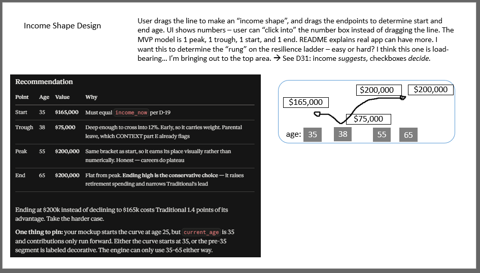
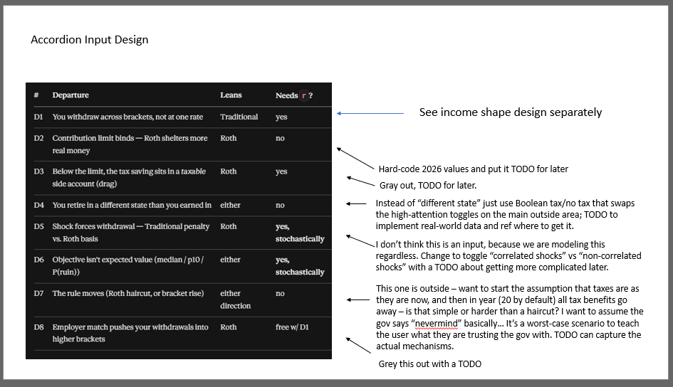
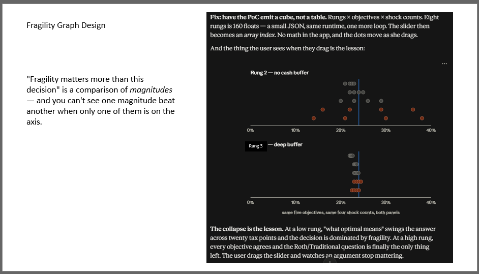
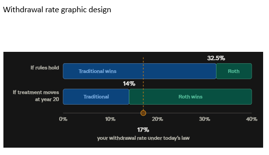

# Design

**What this file is.** The reasoning behind the model and the interface, with the
mockups that carry it. Four parts:

| Part | Holds |
|---|---|
| **1 — The insight** | The claim the whole project rests on |
| **2 — The model** | Objectives, the grid, the resilience ladder, and why shocks are correlated |
| **3 — The interface** | Five mockups, what each one decides, and why |
| **4 — What gate two overturned** | The design errors a cold read caught, and the algebra that caught them |

The engine itself — the five choices that change an answer, the return series,
the shock branches, the cube and the tests — is in [`ENGINE.md`](ENGINE.md). This
file argues *why* the model has its shape; that one is *what it does*.

**How to read the supersession banners.** Parts 1 and 2 keep their design-phase
text. Where a decision later moved, a blockquote says so and names the decision
that won. Nothing is silently rewritten — a superseded reason is evidence about
the method, and deleting it would remove the only proof the method does anything.

`DECISIONS.md` wins over this file on any disagreement.

---

# Part 1 — The insight

**The standard risk-tolerance ladder measures the wrong noun.** Ponzi → stocks →
ETFs → bonds → CDs is an instrument ladder — it ranks the volatility of the thing
you bought. This ladder ranks the fragility of the person holding it. Same
portfolio, two people, completely different risk. The instrument ladder can't see
that. This one can.

A simple grid (worst / best / a few in between) as a scenario matrix. Rows =
objective, columns = shock count. Cells = the break-even rate.

## Objective ladder — "optimal" (row labels for the grid)

| # | Objective | Good at | Bad at |
|---|---|---|---|
| 1 | Max expected after-tax terminal wealth | Simplest | Ignores that you spend it, not stack it |
| ~~2~~ | ~~Max after-tax lifetime spending~~ **CUT — D-06** | Right unit | *Needed a spending model. D-39 made spending a fixed common input, which deleted the precondition. Both accounts then fund identical spending on every path and the difference is identically zero* |
| 3 | Max median outcome | Robust to tails | Hides the tail |
| 4 | Max 10th percentile (regret-minimizing) | Matches how people actually feel | Conservative-looking |
| 5 | P(not running out) | Intuitive | Binary; loses magnitude |

> **Superseded by D-06.** Four objectives ship, not five. The bad-at column above
> is the record of why: *needs a spending model* was objective 2's precondition,
> and D-39 removed it. A gate-two regression, caught by asking what else a common
> draw flattens.

**The demo moment this ladder buys.** Same inputs, swap the objective, watch the
recommendation move. That is *explain the numerical dynamics* delivered as one
radio button rather than a paragraph.

> **MEASURED AT SPRINT 4A, and the demo is narrower than this section assumed.**
> Across objectives 1, 3 and 4 the break-even spread is **1.4656 points at the
> Low rung with three shocks** and **exactly 0.0000 at Mid and High**, at every
> shock count. Swapping the objective moves the answer only for the user who has
> no buffer. **That is not a defect and it is not a smaller lesson than the one
> intended** — it is L3 read down a column instead of across a row, and it says
> the definition of optimal is contested for exactly the population the
> fragility argument is about. The radio button stays. Its caption changes from
> *watch this move* to *watch who this moves for*. Objective 5 reads about 0.08
> points low across the whole grid for a solver reason (D-51), not a modeling
> one.

## The scenario grid — objective × life events

Cells = the break-even future marginal rate.

|                            | 0 events | 1 event | 2 events | 3 events |
|----------------------------|----------|---------|----------|----------|
| Max expected terminal      |          |         |          |          |
| Max median outcome         |          |         |          |          |
| Max 10th percentile        |          |         |          |          |
| P(not running out)         |          |         |          |          |

## How to read the grid

| Read it… | And you learn |
|---|---|
| Down a column | How much your *definition of optimal* moves the answer |
| Across a row | How much your *fragility* moves the answer |
| Bottom-left vs. top-right | Whether the two forces compound or cancel |
| Spread of the whole grid | The honest uncertainty statement — if X ranges 18–34%, "the optimal choice" was never a scalar |

The pattern to expect: rows 1–2 barely move across columns; rows 4–5 move a lot.
Expected-value objectives are nearly blind to shocks, because a shock that halves
your outcome and a boom that doubles it cancel in the mean. Tail objectives see
them immediately. That divergence is the demo — it shows the audience that the
reason people disagree about Roth vs. Traditional isn't the math, it's that
they're silently optimizing different things.

---

# Part 2 — The model

## The resilience ladder

> **Superseded by D-33.** This section originally gave the ladder twice — nine
> stops in one place, ten in another — and the README and the mockup each gave a
> third variant. The canonical ladder is the **ten-stop flowchart ladder**: $400
> · $2,000 · high-interest debt · employer match · medium-interest (~8%) debt ·
> 20% to 401k · max IRA · max 401k · no mortgage · other assets, banded **Low 1–3
> · Mid 4–6 · High 7–10**. It maps to the shock mechanisms tighter than either
> list did, and note the flowchart's own ordering: the employer match comes
> *before* clearing medium-interest debt, because the match is free money.

Define a resilience ladder for the chosen representative median user (someone who
works as a software engineer in energy tech):

$400 → $2k → no high-interest debt → tax-advantaged → sinking funds →
max contributions → backdoor Roth/529 → mortgage payoff → outside assets

**Your rung determines whether a life event is a bump or a forced sale.**

| Rung | What a life event does |
|---|---|
| Low | Forces liquidation — you sell assets to eat |
| Mid | Pauses contributions — you stop buying, keep holding |
| High | Absorbed by cash — the portfolio never notices |

> **Superseded by D-16 and D-32.** Not a slider and not eight stops. **Three
> rungs**, each selecting a *code branch* rather than a severity — low sells at
> the bottom, mid fails to buy at the bottom, high does neither. Eight would have
> meant inventing six intermediate severities with nothing behind them. The
> control is **ten checkboxes**, one per ladder stop, and the rung is the highest
> *contiguous* stop cleared (D-37). A shock is $40,000 real (D-39).

The argument the ladder makes:

```
point 1: the vast majority of us are always borrowing on margin. We have not
paid off our house, and we don't have "all the money we will ever need" — we
are in debt to our future needing to drink clean water and eat food. This
means we are on the hook for a call of that debt and that timing is not in
our power.
```

It also answers "who is this tool for" inside the tool without getting sensitive
— set the rung low and the app can say plainly: **the 401k election is not your
binding constraint yet.**

## The mechanism that makes the tail fat

**Life events are not independent of market drawdowns.**

| Model choice | Resulting tail |
|---|---|
| Shocks drawn independently of returns | Mild, roughly symmetric — wrong |
| Shocks correlated with drawdowns | Non-linear, fat — because forced liquidation happens exactly when prices are worst |

This is the margin call. Not levered on paper, but: a 40-year obligation to eat,
no free borrowing against future wages, and the recall timing is set by the same
process that sets asset prices.

> **Superseded by D-08.** This section originally read "ONE correlation
> coefficient carries the whole argument." There is no coefficient. Shocks are
> placed into each path's worst years by drawdown `argsort` — the placement *is*
> the correlation, so there is nothing to calibrate and nothing to defend. An
> uncorrelated toggle scatters them randomly for contrast, which makes the tail
> appear and disappear in one click.

Energy analog: a financed solar customer who loses income in a downturn must
default or sell at the moment resale value is lowest. Correlated exogenous
timing, forced sale at the bottom. Same shape.

## Tail visual — options, simplest → most complex

| # | Design | Good at | Bad at |
|---|---|---|---|
| 1 | Percentile fan chart over time | Familiar; free from any MC run | Everyone's seen it; the eye reads the middle, not the edges. **Hides asymmetry** — the thing you want to show |
| 2 | Two bars: gain at p90 vs. loss at p10, both relative to median | Asymmetry is the whole picture, instantly | Loses time structure |
| 3 | **The exchange rate** — "safety costs $X of upside, buys $Y of downside protection" | Literally the point. One sentence, one ratio, no chart-reading required | Needs a defined "safe" comparator |
| 4 | Loss-side histogram only, upside truncated | Honest about what's fungible (upside) vs. what isn't (ruin) | Reads pessimistic; some will bounce off it |
| 5 | Full regret surface / 2D heatmap | Complete | Over budget, over-reads |

DECISION: Pick 3, with 2 as the visual under it. #3 is the sentence a user
repeats to their spouse, which is the real test.

> **Partly superseded.** #3 survives as the $X/$Y sentence. The two-bar chart
> under it was **cut** and is a Scope & Branches row — it teaches that outcomes
> are left-skewed, which is adjacent to L3 rather than the same as it. The $X/$Y
> sentence carries L3 alone.

---

## Where the model becomes an engine

Everything above argues why the model has this shape. What the engine *does* with
that shape — the five choices that change an answer, the return series, the three
shock branches, the cube, and the tests — is in [`ENGINE.md`](ENGINE.md).

Two of those choices hold up arguments on this page, so they are worth naming
here even though they are specified there:

| Choice | What it holds up |
|---|---|
| **Same pre-tax dollars** — $X into Traditional against $X·(1−t) into Roth | L1. The growth factor divides out only under this convention, so *the return rate never affects the choice* is a consequence of it rather than a separate fact |
| **Nothing clamped at zero** — balances go negative, ruin is a recorded flag | The grid in part 1. Objectives 1–3 bisect on a difference between two terminal values, and that difference is monotone in the future rate only if the arithmetic is allowed to run |

And one measurement from `ENGINE.md` belongs to the argument in this part: the
block bootstrap was picked to fatten the tail, and **measurement showed it thins
it.** The pick survives on a different channel. That is the row where this
project's own methodology got tested on itself.

---

## Vocabulary anchors

| Term | What it names |
|---|---|
| **Sequence-of-returns risk** | Order matters, not just average return — same returns in a different order give a different outcome once you're withdrawing |
| **Liquidity constraint** | You can't borrow freely against future wages. The formal version of the margin framing |
| **Buffer-stock saving** | Deaton / Carroll — why people rationally hold precautionary cash. The rung ladder *is* this theory, drawn |
| **Downside deviation / semi-variance** | Volatility measured only below a target, not around the mean |
| **Certainty equivalent** | The guaranteed amount you'd accept instead of the gamble. Formal version of the exchange rate |
| **Ergodicity** | Ensemble average ≠ time average when ruin is absorbing |

### Three words this project had to name itself

The six above are borrowed from the literature. These three are not — they are
the project's own, written at Sprint 3A as **D-44**, because three different
quantities in this model were all being called *drawdown* and two of them are not
the same quantity. The engine could not implement one of them until the word
picked out exactly one.

| Term | What it names | Shape |
|---|---|---|
| **`path-drawdown`** | The deepest peak-to-trough decline of the cumulative return index, over whatever window it is handed | **One number per path** |
| **`underwater-depth`** | How far below its running peak the index sits at the end of a given year | **One number per year** |
| **`worst-year-return`** | The annual real return itself | **One number per year** |

**`path-drawdown` is what −59.6% is**, and `engine.path_drawdown()` computes it.
The relation between the first two is the definition rather than a coincidence —
`path-drawdown` is the minimum of `underwater-depth` over the window — and the
test suite asserts it, which is what stops a later sprint from inventing a
second, subtly different underwater curve.

**`worst-year-return` loses the word entirely, and that is the point of the
split.** It was never a drawdown. Calling it one is most of why D-08's placement
rule — *shocks land at the `n` worst years* — reads two ways, and those two
readings pick different years on the same path. Sprint 3A deliberately did not
choose. **Sprint 3B chose `underwater-depth` (D-45), and the two readings were
not close** — at three shocks they agree on the year set for 8.1% of paths,
measured by `scripts/measure_3b.py` §4.

**One computed on the return index, never on a balance.** `path-drawdown` is a
property of the return *model*. An account balance carries contributions, which
arrive every year and buy at the bottom, masking the decline they are supposed to
measure. There is no profile in that function's arguments and the absence is the
argument.

*(The naming also had to survive grep. Three distinct tokens with no shared
prefix means `grep drawdown` minus `path-drawdown` returns a set small enough to
read — which is how the remaining ambiguous uses in this file were found once 3B
resolved them.)*

---

# Part 3 — The interface

Five mockups, drawn during the design phase. Each one decides something, and each
caption says what it decides, why, and what moved afterwards.

**Read these as working surfaces, not as specifications.** `DECISIONS.md` §7 is
the layout contract. Where a mockup and a decision disagree, the decision wins —
and several of them disagree, on purpose, because the disagreements are the
record of what design review caught.

## 3.1 — Full layout


**What it decides.** Where everything sits, and therefore what the user compares
against what.

| Choice | Why |
|---|---|
| Return buttons sit **beside** the tax controls | L1 and L2 are taught by contrast. One set moves the answer, the other cannot, and adjacency is what makes that legible without a sentence |
| **Both thresholds** on screen at once, never behind a click | Roth bets the treatment holds, Traditional bets the rates do. Showing one and hiding the other makes a bet look like a default (D-10) |
| Ladder is the **left rail**, always visible | L3 claims fragility outranks the account choice. A control you have to scroll to cannot outrank anything |
| **Three** dot panels, user's highlighted, other two dimmed but present | The collapse is the lesson, and a trend needs three points. Showing only the user's rung deletes the comparison that carries L3 |
| Accordion at the **bottom, closed** | Progressive disclosure — one sentence up front, mechanism behind a toggle. The eight departures are evidence of completeness, not the first thing to read |
| **Disabled** "Model (block bootstrap)" box with a tooltip listing all nine return models | The option space was mapped and two were built. Disabled rather than absent says so without implying the other seven exist |

**What moved.** The threshold bar embedded in this mockup is **wrong** — see 3.5
and part 4. The layout around it is current.

**One number to treat with care, and the cube has now run.** The mockup reads
*"moving from mid to high resiliency is worth ~$Y — about four times the account
choice."* That ratio was a design-phase estimate and existed nowhere in
`DECISIONS.md`. Sprint 4A's third gate warned that `$Y` might come out near `$X`.

> **MEASURED AT SPRINT 4A. It fired, and it landed the other side of the
> prediction.** At D-23's cell — objective 4, one shock, the Low rung, δ = 10 —
> `$X` is **$1,602,313** against `$Y` at **$756,988**, a ratio of **0.47×**. `$Y`
> is not near `$X`. It is half of it, so the estimate is off by roughly eight
> times in the direction that costs the lesson. **The 4× is retired, not
> restated.** `$Y` is also invariant in δ, which means δ chooses the verdict: at
> δ = 2 the ratio is 2.86× and L3 reads strong. **The dot plot carries L3 without
> the sentence** — 8.13 points of collapse at Low against zero at Mid and High —
> which is what this section already said it would do either way. The README's
> `## Results` carries the full reading and `scripts/measure_4a.py` §3 and §5 are
> the runnable source.

## 3.2 — Income shape



**What it decides.** D-19's four points — (35, $165,000) · (38, $75,000) ·
(55, $200,000) · (65, $200,000), linearly interpolated.

| Choice | Why |
|---|---|
| The curve is **draggable**, with click-into number boxes | A peak year is a high-bracket contribution year and a trough is a conversion window. Dragging is how a user discovers that without being told |
| One peak, one trough, one start, one end | The MVP model. A real app can have more, and the README says so |
| Trough at 38 = **parental leave** | `CONTEXT` part E derives it from a 12-week parental leave. It is this population's low-bracket window |
| Ending **flat from the peak** rather than declining | Ending high is the *conservative* case — it raises retirement spending and narrows Traditional's lead. Take the harder case |
| Income **suggests** a rung; the checkboxes **decide** it | Deriving fragility from income reintroduces the exact error part 1 names: income is a fourth instrument ladder. Two markers make the disagreement visible (D-31) |

**What moved.** Nothing numeric. This is the one mockup that reproduces the
decision exactly.

**One number to treat with care.** The mockup states *"ending at $200k instead of
declining to $165k costs Traditional 1.4 points of its advantage."* D-19 makes
the qualitative claim but not the measurement, so 1.4 lived only in this picture.
~~Treat it as a design-phase estimate pending Sprint 2A, which builds the income
curve and can measure it directly.~~

**MEASURED AT SPRINT 2B, AND IT IS 0.0.** The income curve landed at 2A and the
draw at 2B, so the claim is checkable end to end. Both shapes return `t_now`
32.50%, a 15.18% marker, a 17.32-point advantage and a $108,397 draw — identical
to the dollar, with the policy threshold at 58.4064% either way. **The deferral
cap is the reason.** A 20% savings rate passes $24,500 above an income of
$122,500; the declining profile is still earning $168,500 at age 64, with $33,700
of capacity against a $24,500 cap. Every year of the 55→65 leg is capped under
both shapes, so the terminal income cannot reach the balance at 65 and nothing
downstream of it can move. The estimate was not wrong by 1.4 points — the
mechanism it named is invisible at this income. **The early-career preset does
not rescue it either:** it starts under the cap but ends at $200,000, so its end
point is capped as well. The effect needs a profile whose *final* leg stays under
$122,500, and there it is a fraction of the claimed size — ending at $90,000
rather than $110,000 moves the marker by 0.13 points. D-19 carries the
correction and the README's `## Results` carries the finding.

## 3.3 — Accordion of departures



**What it decides.** The eight mechanisms that move the answer, which of them are
modeled, and which are visible-but-grayed.

| Choice | Why |
|---|---|
| All eight rows render, **including the grayed ones** | The grayed rows are the evidence of completeness. Deleting a scoped-out mechanism makes the model look smaller and less considered than it is |
| D4 — retirement-state tax — **stays editable** when the rest goes read-only | It is the correction most users should apply to the default, and defaults are earn-taxed / retire-untaxed, the widest honest case (D-30) |
| D3 and D8 grayed with visible `TODO` | Both are real effects. The taxable side account and the employer match are Traditional-flavored money that arrives whether or not you choose it, so almost nobody is a pure case. Saying that is worth more than modeling it badly |
| Each row names its **lean**, not its verdict | A departure that leans Roth is not an argument for Roth. The threshold is the argument |

**What moved.** D7's note in this mockup reads *"in year 20 all tax benefits go
away."* D-09 narrowed it to **Roth only**, and that narrowing is the whole policy
argument: Traditional needs no branch at all, because its withdrawals were
already ordinary income, and **that absence in the code is the asymmetry.** Making
it symmetric would delete it — and would still not flip the archetype toward
Roth.

That same phrase is the traceable origin of the error in 3.5. *All* benefits
going away, including Traditional's deduction, could plausibly move the threshold
down. Roth-only cannot.

## 3.4 — Fragility panels



**What it decides.** How L3 gets shown rather than asserted.

The framing on this slide is the reason the panels exist at all: *"fragility
matters more than this decision" is a comparison of magnitudes — and you can't
see one magnitude beat another when only one of them is on the axis.*

| Choice | Why |
|---|---|
| Emit a **cube**, not a table | Rungs × objectives × shock counts precomputed. The control becomes an array index, the app does no math, and the dots move instantly |
| Row = shock count, color = objective family | Gray for expected-value objectives, orange for tail. Gray dots barely move down the rows while orange dots fan out — the expected-value-vs-tail divergence, free alongside L3 (D-34) |
| **No jitter** | Rows already separate the dots. Overlap within a row means the objectives agree, which is information rather than clutter |
| The collapse is the lesson | At a low rung the four definitions of "optimal" disagree across a wide span of tax points; at Mid and High they land on **one identical value**. That is now derived rather than hoped for (D-22): only Low's penalty is asymmetric, so 36 of 48 cells equal `t_now` exactly. **The collapse is a cliff, not a gradient** — and the cliff is the stronger statement |

**What moved — most of the numbers on this slide.**

| Mockup | Now |
|---|---|
| Eight rungs, 160 floats | **Three** rungs, **48** cells (D-16, D-06) |
| A **slider** feeding shock severity | **Ten checkboxes**; the rung selects a code *branch*, not a severity (D-16, D-32) |
| Panels labeled "Rung 2", "Rung 3" | **Named, never numbered** — Low, Mid, High |

The slider is the substantive one. Eight stops would have meant inventing six
intermediate severities with nothing behind them. Three rungs are three
mechanisms: low sells at the bottom, mid fails to buy at the bottom, high does
neither. Three real branches beat eight interpolated ones.

## 3.5 — Withdrawal-rate graphic



**What it decides.** The headline. Two thresholds on one rate scale, so "which
side am I on" is a spatial question rather than an arithmetic one.

| Choice | Why |
|---|---|
| One shared axis for both thresholds and the marker | The gap between them *is* the lesson. Separate charts would hide it |
| The marker is an **effective** rate; `t*` is a **marginal** rate | Different units on one axis, and the axis says so. You defer at marginal and withdraw across the whole structure from zero |
| Bracket-rise needs no second model | It is already the axis. A higher future rate is a position to the right of `t*` |

**What moved: every number on this slide, and the direction of the argument.**

| Mockup | Now |
|---|---|
| Second threshold at **14%** | **58.4%** (D-40) |
| **Roth wins** to the right of it | **Traditional** wins, by more |
| Marker at **17%** | **15.2%** (D-24) |

Part 4 is the algebra that forced the reversal.

**What moved again at Sprint 6: not the numbers this time, the reading.**

| This slide | Shipped |
|---|---|
| **Two thresholds on one rate scale**, drawn as two positions | **One bar** — the toggle-selected scenario — with the other scenario drawn as **movement**: a span from the current edge to where the edge goes, labelled with the consequence in words |

D-40 corrected the numbers and the direction. **It did not correct the reading,
and the build repeated the error one layer down.** Round 2 kept the inactive
threshold as a bare ghost tick on the active scenario's bar — and **a tick
inherits the colour it is drawn on, which belongs to the OTHER scenario.** At the
early-career preset the inactive threshold is 29.1%, which lands inside the green
*Roth wins* band, so the chart read *29.1% is Roth territory* when crossing it is
exactly what puts that user on **Traditional**. The most counterintuitive finding
in the project, drawn backwards for the second time, by a different mechanism.

Movement rather than position is the fix, and the reason is a property of the
medium rather than a preference: **words cannot be recoloured by the band
beneath them.** The legend moved to the bottom in the same pass — at the top it
shared a 40px band with the boundary and marker labels, and all three
overprinted in a narrow container. Both are recorded in DECISIONS §7's
departures table, which is the contract side of this page.

---

# Part 4 — What gate two overturned

Design gate two was a cold read: a fresh agent, no access to the design
conversation, no memory of the project, given the five documents and the five
mockups above. Acceptance test — reproduce `t*` = 32.5%, the today's-law marker,
and the year-20 flip **from the documents alone.**

Two of three reproduced. The third is impossible as specified, and that is the
most valuable thing the gate produced.

## The mechanism that does NOT make the tail fat

Part 2 is right that correlated shock timing is what makes the tail fat. Gate two
found that the neighbouring claim — the one drawn in 3.5 — was backwards.

A "nevermind" policy that harms only Roth **cannot** flip a Traditional verdict
to Roth. Solving for the tie under D-26's frozen allowance `A`:

```
t*_policy  =  t_now · T₆₅  /  ( t_now · T₆₅ + A )
```

which exceeds `t_now` whenever `A < R₆₅` — and `A` is the Roth balance **eleven**
years before 65 (year 20 is age 54, D-26), so it always is. The threshold moves
**right**, away from the marker. At the reference archetype: 32.5% under current
rules, 58.4% once the treatment moves, against a 15.2% marker.

**CORRECTION, Sprint 2A — the expression above is right and its symbols are
under-labeled.** Both terms are future values at 100: `t_now·T₆₅·(1+r)³⁵` against
`S·A₁`, the compounded value of the withdrawals the allowance funded, which is
$5,211,109 at the archetype rather than the raw $607,475. Substitute age-65
magnitudes and the same expression returns **53.0%**, not 58.4%. The inequality
and therefore the whole argument of this section are unaffected — only the
number a reader recomputes by hand. D-40 carries the corrected form.

So the archetype's lesson is the honest one: *the scenario you were told makes
Roth safe is the one that widens Traditional's lead.* The flip is real, but it
belongs to the low-bracket saver — the early-career preset reads 12.0% against a
15.9% marker (Roth), then 29.1% once the rule moves (Traditional).

**The error is traceable, which is why it is worth writing down.** 3.3's D7 note
said *all* tax benefits go away. All benefits — including Traditional's deduction
— could plausibly move the threshold down. D-09 and D-26 narrowed it to Roth
only, for a good reason, and **the graphic was never recomputed.** A decision
moved and a picture didn't follow it.

**This is the same shape as part 2's insight, one level up.** The instrument
ladder can't see that two people holding the same portfolio face different risk.
The policy toggle couldn't see that the same rule change lands on two savers in
opposite directions. Both errors come from measuring the object instead of the
person holding it.

## The other two findings

**80% replacement of final working income bankrupts both accounts** — Roth at 79,
Traditional at 92. $160,000 a year against a $24,500 cap is not fundable at any
return rate, and objective 1 returned $0 = $0 with no crossing. The draw is now
sized off the Roth (D-39), and the honest consequence — 54% of final income — is
published rather than hidden.

**`t*` reproducing is less impressive than it looks.** Under D-01 the after-tax
Traditional trajectory is the Roth trajectory scaled by `(1−t_later)`, so in the
base case `t*` **is** `t_now`. The number is a definition, not a result, and the
app says so: *at these settings the break-even is just your current combined
rate; here is what moves it.*

Full record in [`review/GATE-2.md`](review/GATE-2.md). Gate one is in
[`review/GATE-1.md`](review/GATE-1.md).
