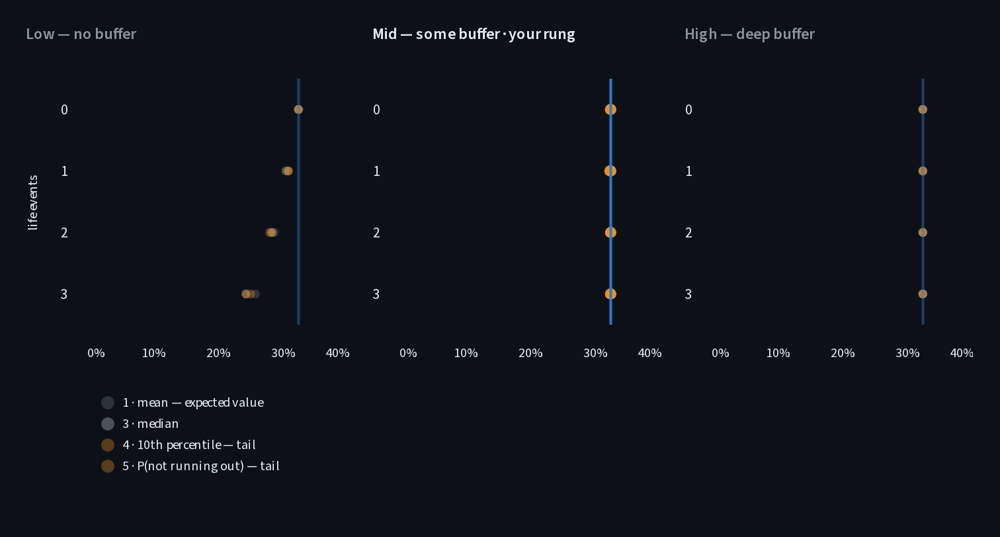

# Findings

The [README](../README.md) gives the short version.
This page gives the measurements behind it, what they taught me about models, and how two AI builds of the same app compare.
Every number traces to [RESULTS](RESULTS.md) or to a committed run.

<b>The setup</b>, for checking the numbers

- The reference saver is 35, files single, and earns $165,000, on an income path that dips at 38 and reaches $200,000 at 55.
- Contributions are deferred at 32.5%: 24% federal plus 8.5% state.
- The saver puts 20% of pay into the account until 65, up to the $24,500 annual limit, then draws a level real amount until 100.
  The limit binds in 22 of the 30 working years.
- Both accounts get the same pre-tax dollars.
  Once the limit binds, a Roth could shelter more of the saver's budget, and the model leaves that out, which favors Traditional.
- A life event costs $40,000 in today's dollars.
  I place each event in a year when the market sits furthest below its last peak, on the assumption that layoffs and bad markets arrive together.
  Against random placement, that lowers Traditional's 10th-percentile balance at 65, for a no-buffer saver, by 4.7% after one event and 13.6% after three ([RESULTS §7.1](RESULTS.md#71-placement-matters-and-it-is-the-cheapest-demonstration-in-the-project-)).
- The risk panels, the ruin counts and the dollar comparisons all come from the same 2,000 paths of real S&P 500 total returns, 1928–2025, resampled in five-year blocks from a fixed seed.
  The headline break-even, the rule-change thresholds and the withdrawal rates use a fixed 7% real return.
- Nothing is floored at zero.
  "Runs out" means a path's balance went below zero before 100.

## 1. Settled with a buffer, contested without one

*Break-even future tax rate after zero to three life events, for savers with no buffer, some buffer and a deep buffer. Each dot is one definition of "optimal": the mean, median or 10th percentile of wealth at 100, or the chance of not running out. The legend numbers them 1, 3, 4 and 5, because a second definition, lifetime spending, drops out: both accounts fund the same spending. The vertical line is the reference saver's break-even under today's rules, 32.5%.*

The app's ladder is based on the [r/personalfinance flowchart](https://imgur.com/personal-income-spending-flowchart-united-states-lSoUQr2), simplified into ten stops: $400 of cash, then $2,000, high-interest debt, the employer match, and on up to other assets.
The flowchart takes the match before high-interest debt, as free money.
I reversed the two, because a match can be worth more or less than the interest the debt charges.
Stops 1–3 make the no-buffer rung, 4–6 the some-buffer rung, and 7–10 the deep-buffer rung.
Each rung meets a $40,000 life event its own way:

| Rung | What the event does |
|---|---|
| No buffer | Forces a sale from the retirement account, in a down market |
| Some buffer | Pauses contributions for that year, so the account skips buying in a down market |
| Deep buffer | Comes out of cash. The account never sees it |

Only the sale treats the two accounts differently.
Traditional owes income tax and the 10% early-withdrawal penalty on what it sells, so it sells more to raise the same $40,000.
Roth contributions come out free.
A paused contribution costs both accounts in the same proportion, and a cash payment costs them nothing, so neither can move the break-even.
That let me derive 36 of the 48 cells before the run: every cell with a buffer, and every cell with no events, had to equal today's rate exactly.
The run confirmed all 36.
(One definition reads a fraction of a point low, a solver artifact explained in [RESULTS §8.4](RESULTS.md#84-one-objective-reads-slightly-low-and-it-is-the-solver-not-the-model-).)

Without a buffer, each event pulls the break-even down:

| Life events | 0 | 1 | 2 | 3 |
|---|---|---|---|---|
| No buffer | 32.5% | 30.9% | 28.0% | 24.4% |
| Some buffer | 32.5% | 32.5% | 32.5% | 32.5% |
| Deep buffer | 32.5% | 32.5% | 32.5% | 32.5% |

*Definition used: the 10th percentile of wealth at 100 ([RESULTS §8.1](RESULTS.md#81-the-collapse-)).*

For the reference saver, Traditional still wins on every rung.
Under today's law, the saver's withdrawals are taxed at an average of 15.2%, below even the lowest break-even.
The movement matters to a saver who expects a retirement tax rate between 24.4% and 32.5%.
With a buffer, Traditional wins for that saver.
Without one, three events move the 10th-percentile answer to Roth.

With a buffer, the four definitions of optimal agree.
Without one, they drift apart, by 1.47 points after three events ([RESULTS §8.2](RESULTS.md#82-the-objective-menu-is-contested-only-at-low-)).
So the definition of "optimal" is contested for the same savers the account choice is contested for.
After three events, that disagreement decides the verdict only for a saver whose retirement rate lands between 24.4% and 25.8%.

The app withholds its verdict from a saver who has not cleared the first two stops.
It names the missing stop and keeps every number on screen.
An unticked high-interest-debt stop adds one line: paying it off beats either account, at any tax rate.

### What a rung of buffer is worth

I expected one rung of buffer to be worth about four times the account choice, in dollars.
The comparison turns on δ, how far your actual retirement tax rate lands from the break-even.
I fixed δ at 10 points before the sweep ran.
A smaller δ would have flattered the buffer, which was the claim I expected to hold.

| δ, distance from the break-even | 2 points | 10 points |
|---|---|---|
| One rung of buffer, as a multiple of the account choice | 2.86× | 0.47× |

*No buffer, one event, the 10th percentile of wealth at 100 ([RESULTS §8.3](RESULTS.md#83-the-design-estimate-was-wrong-by-about-eight-times-and-δ-is-why-)). At that percentile the path has already run out, so these dollars measure how deep the hole gets, not wealth ([RESULTS §6.3](RESULTS.md#63-nothing-is-floored-and-the-tail-numbers-are-signed-)).*

The two cross between 4.8 and 6.1 points, depending on the definition of optimal.
A rung of buffer is worth more when the account choice is a close call.
The account choice is worth more when it is not.
I kept δ at 10, retired the four-times estimate, and published the crossing.

### Unless the rule moves

Everything above assumes today's tax treatment holds.
I also modeled a rule change: twenty years from now, Roth withdrawals above a frozen allowance become taxable, and Traditional is untouched.
A change that harms only Roth raises the break-even, from 32.5% to 58.4% for the reference saver, so Traditional's lead widens.
My design deck drew the threshold moving the other way.
A cold review, by a fresh agent reading only the documents, caught it.
The answer flips for the early-career preset instead: a saver who earns $60,000 at 35, reaches $200,000 at 55, and pays no state income tax while working.
That saver expects to withdraw at 15.9%.
The break-even is 12.0% under today's rules, so Roth wins, and 29.1% after the change, so Traditional wins.
The rule change costs the low-bracket saver Roth was supposed to help ([RESULTS §4](RESULTS.md#4--when-the-rule-moves)).

## 2. What models are for

A buffer puts the saver in a regime where the pencil answer is exact.
Without one, the pencil answer breaks, and it takes the full model to say by how much.
Nobody knows in advance which regime a given year will bring, because a layoff or a medical bill can empty a buffer.

### The shape changes, not only the position

In the panels, a saver with a buffer keeps all four dots on one line at every event count.
Without a buffer, the dots shift left, and they spread apart.
Animators call this squash and stretch: a shape that deforms as it moves.
The spread comes from path dependence, the interaction between when the cash is needed and what the market is doing that year.
A fixed-rate engine gives one path, and on one path the mean, median and 10th percentile are the same number, so the dots cannot spread.
I listed nine return models, from a fixed rate up to correlated paths for inflation, wages and tax policy.
I stepped from a fixed rate through Monte Carlo to a block bootstrap, which replays real five-year runs of market history.
The app ships two: a fixed real rate for the headline, where the return cancels out, and the block bootstrap for the risk panels.

The block bootstrap is not fancy machinery for its own sake.
It supplies enough different economic paths for a thin buffer to interact with timing.
Without a buffer, small differences in timing produce large differences downstream, and it takes many paths to show it.
I chose the block bootstrap to fatten the tail, and it thins it slightly ([README](../README.md#what-didnt-survive)).
I kept it for a different reason: a forced sale at the bottom misses the rebound, and the block bootstrap replays real rebounds, +17.1% in the year after a path's worst year against +10.1% for independent draws ([RESULTS §5.1](RESULTS.md#51-the-block-bootstrap-was-chosen-to-fatten-the-tail-it-thins-it-)).

### Counting outcomes

A model cannot tell you which regime next year brings.
It can count.
Out of every 100 simulated lifetimes, this many Roth savers run out of money before 100:

| Life events | No buffer | Some buffer | Deep buffer |
|---|---|---|---|
| 0 | 49 | 49 | 49 |
| 1 | 55 | 50 | 49 |
| 2 | 62 | 53 | 49 |
| 3 | 70 | 55 | 49 |

*2,000 paths per cell. A Roth balance does not depend on the future tax rate, so this count needs no guess about it. Traditional's count does depend on that rate. Section 2 of [the script's saved output](../scripts/out_measure_4a_20260819-2237.txt) has the exact figures, with Traditional's read at 32.5%.*

The zero-event row sits at 49 because the withdrawal is sized to the series' compounded return, and against a 19.3% standard deviation about half the paths fall short of it ([README](../README.md#what-didnt-survive)).
The finding is in how far each column climbs.
A deep buffer holds at 49 however many events arrive.
Some buffer reaches 55 after three events, because each paused year skips buying low.
No buffer reaches 70, because each forced sale sells low and misses the rebound.
You do not need statistics to find your column.

## 3. The same problem in three domains

My PhD work modeled radiation damage in the oxides of bipolar transistors ([1](#references), [2](#references)).
Two mechanisms produce the protons that build up interface traps.
Direct proton release dominates at low hydrogen concentrations, and H₂ cracking dominates at medium and high ones.
Each mechanism alone matches the data in its own regime.
The two together match it across the whole range.
A model checked against data from the other regime looks wrong.
That is how a good model ends up reported as wrong.
Knowing the regime buys a cheaper calculation and a clearer explanation.
Some effects never separate cleanly, and those always need the full model.

The same structure runs through this repo and through rooftop solar:

| | Retirement (this repo) | Rooftop solar | Transistor oxides (my PhD) |
|---|---|---|---|
| The regime variable | The saver's buffer | The export credit rule, and the share of output used on site | Hydrogen around the device |
| The cheap model | Two tax rates | Output times the retail rate | One mechanism |
| Where the cheap model holds | Any buffer: an event never forces a sale | Output used on site, or exports credited at the retail rate | Low hydrogen (direct release), or medium and high (cracking) |
| Where it takes the full model | No buffer: events force sales in down markets | Exports credited below retail, or time-of-use rates: an hourly model of load, output and tariff | The crossover, where both mechanisms contribute |

The thesis also taught me to look for the one uncertain input that decides the headline.
A 0.1 eV change in one energy barrier, inside the error bound of the calculation that produced it, shifted the hydrogen response by an order of magnitude or more ([1](#references)).
Here δ plays that role for the buffer-versus-account comparison, so I published where it flips instead of a single ratio.

## 4. What a one-prompt AI build got right, and what it put last

On August 21, 2026, I gave Claude Fable 5, at high effort, one line:

> Traditional or Roth? Make an app to answer. Decide everything yourself. Don't read any of my memories.

(The last sentence keeps it from drawing on my earlier chats.)

It built a clean React calculator in about twenty minutes.
It framed the decision as "one bet": your marginal rate now against your rate in retirement.
The math is right, and it compares the same pre-tax dollars in both accounts, the convention this repo uses too.
Its defaults, 22% now and 12% later, give Traditional by $5,427 on a $10,000 contribution over 25 years at 7%.
Everything else sits below the fold, under "Tiebreakers."
The last line on the page is the caveat I would put first: "Assumes the tax saved by Traditional actually gets invested — if it'd get spent, Roth wins by default."
Nothing in it considers a saver who has to sell early.

A second run, the same morning, got a longer prompt with instructions about presenting the answer and about what a simple answer leaves out.
It did not separate the analysis from the presentation: it built one page in five parts, half app and half slide deck.
Its math matches the first run: "Growth doesn't matter. Multiplication commutes."
It adds one refinement: withdrawals fill the brackets from zero, so on its 2025 brackets a retiree spending $60,000 a year pays about 8.6% against a 24% deduction.
It moves the contribution cap from a tiebreaker into the argument.
It gets close to the threshold idea: "an honest tool should output a recommendation with an uncertainty band, and 'split your contributions' is the rational hedge when the band straddles the break-even."
In its fifth part, not shown here, the point that saving behavior matters more than the election comes after the decision rule.
Its list of simplifications includes constant returns and does not mention early withdrawals.

Both runs knew the textbook answer and stated it with confidence.
The textbook answer is right for savers with a buffer.
My question was whether a single answer exists.
With a buffer, it does.
Without one, the break-even moves with each event and the definitions of optimal disagree, so the answer depends on where your rate lands.

The prompt, the code and the screenshots are in [ai-comparison](ai-comparison/README.md).

## 5. What I would do differently

- **Put the panels on the first screen.**
  I faulted both AI builds for putting the caveat last, and my app opens on the verdict too.
  The panels that carry the finding sit below it.
- **Sweep the savings rate.**
  The model holds it at 20% of pay, capped at the annual limit, and saving steadily for decades is the lever most people control.
- **Count the Roth's extra room once the limit binds.**
  The limit binds in 22 of the 30 working years, and the model leaves that room out.
- **Run the grid at a second profile.**
  Every risk panel comes from one reference saver.
  I have not measured how far the dots move for a different saver in the same segment ([RESULTS §11](RESULTS.md#11--known-limits)).
- **Compute the two known biases.**
  Omitting the over-65 deduction understates Traditional by 1.7 points.
  Ignoring the deduction for state income tax overstates it by 2.0 points, for a saver who itemizes.
  Both numbers come from hand arithmetic, not from the code ([RESULTS §9](RESULTS.md#9--what-the-model-gets-wrong-on-purpose)).
- **Prune the working docs every sprint.**
  I let the model write them as the work happened, and each session built on the last one's docs, tone included.

## References

1. N. L. Rowsey, M. E. Law, R. D. Schrimpf, D. M. Fleetwood, B. R. Tuttle and S. T. Pantelides, "A quantitative model for ELDRS and H₂ degradation effects in irradiated oxides based on first principles calculations," *IEEE Transactions on Nuclear Science*, vol. 58, no. 6, pp. 2937–2944, Dec. 2011. [doi:10.1109/TNS.2011.2169458](https://doi.org/10.1109/TNS.2011.2169458)
2. N. L. Rowsey, M. E. Law, R. D. Schrimpf, D. M. Fleetwood, B. R. Tuttle and S. T. Pantelides, "Mechanisms separating time-dependent and true dose-rate effects in irradiated bipolar oxides," *IEEE Transactions on Nuclear Science*, vol. 59, no. 6, pp. 3069–3076, Dec. 2012. [doi:10.1109/TNS.2012.2222669](https://doi.org/10.1109/TNS.2012.2222669)

[Back to the README](../README.md)
